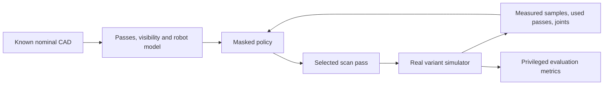
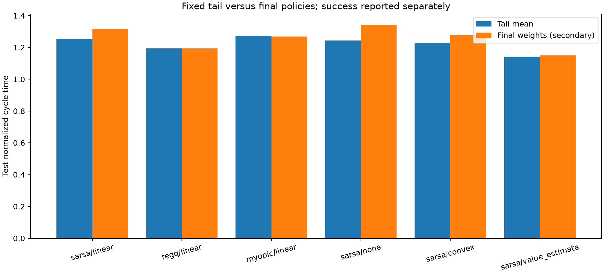
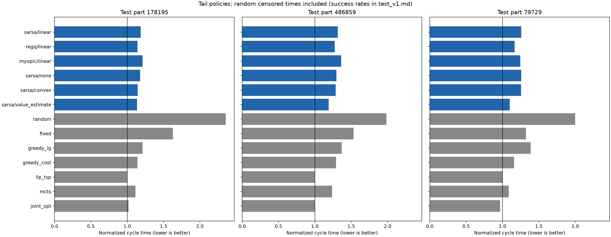

# NBV-RL: Learning Next-Best-View Scan Planning for Line-Laser Inspection

## Abstract and status

Project documentation is versioned: [problem and assignment](docs/PROJECT.md), [frozen protocol](docs/PROTOCOL.md), [decisions](docs/DECISIONS.md), [literature](docs/LITERATURE.md), [demo guide](docs/DEMO_GUIDE.md), [Phase 1 plan](docs/plans/done/002-classical-rl.md) and [Phase 2 draft](docs/plans/003-deep-rl-and-ablations.md). Historical commit references in the immutable registry and evidence are resolved by the separate [old-to-new commit map](results/provenance/commit_map_v1.csv); original artifacts retain their recorded hashes.

A robot-mounted line-laser profilometer must cover a cast part with little robot motion and scanning time. This graduate Deep Reinforcement Learning course project studies a known-CAD, next-best-view problem with discrete scan passes, dual laser/camera occlusion and estimated joint-space cycle time. Phase 1 compares hand-written NumPy true online SARSA(lambda), regularized linear Q-learning and a myopic learner against cost-aware greedy, MCTS, ILP+TSP and a joint planning reference. All predeclared Phase 1 hypotheses are rejected. The value_estimate shaping arm has consistently lower SARSA means across train, validation and test; this is a descriptive finding with an unverified mechanism. Tail averaging improves the reliability of the deployed policy relative to the secondary final weights. Phase 2 will examine richer state-action representations; no deep agent has been trained for this report.

| Plan | Scope | Status |
|---|---|---|
| 001 | Environment, visibility, robot masks and baselines | Completed |
| 002 | Phase 1: classical RL and frozen test report | Completed |
| 003 | Phase 2: deep RL and ablations | Draft; requires user approval and PROTOCOL v2 |
| 004 | Visualization and demos | Completed, including optional local VAL viewer |
| 004b | Recorded-path collision audit and presentation polish | [Completed](docs/plans/done/004b-polish.md) |
| 005 | Final analysis and paper | Not started |

The source of numerical results is [results/registry.csv](results/registry.csv). Tables between `BEGIN GENERATED` markers are inserted by `uv run python scripts/report_phase1.py`; they are not manually transcribed. Detailed evidence: Plan 002, decisions, frozen PROTOCOL v1, and the [complete test report](results/test_v1.md). This README documents Phase 1, not an industrial deployment or a completed Phase 2 experiment.

## Problem and relationship to the assignment

The assignment is **Ödev 7: 3B Lazer Tarama ve Kalite Kontrol Hücresinde En İyi Sonraki Bakış Açısı (Next-Best-View) Planlama**. Its original wording is preserved in PROJECT.md: select the sensor's next position/orientation from a measured/unmeasured surface representation; reward new information while penalizing robot travel and scanning; the suggested method is SAC.

We make three explicit adaptations. First, a line laser measures during a sweep, so an action selects a complete scan pass from a fixed candidate set rather than an unconstrained instantaneous viewpoint. Second, the cost is estimated UR5 joint-space movej time plus scan and return-home time, rather than Euclidean distance. Third, the environment reward contains only the task objective; potential-based coverage shaping belongs to the agent. These choices are recorded in D-020, D-022, D-024, D-029 and D-038. Phase 1 follows the course ban on neural networks; SAC remains a proposed Phase 2 main arm, alongside a masked discrete learner (D-008/D-040).

The research question is whether a learned planner can generalize to unseen **base-part types**, cover their observable surfaces efficiently and approach a strong CAD planner. Knowing the CAD makes greedy and solver-based baselines essential. We do not claim that an RL policy should outperform an analytic planner merely because it was learned.

## Environment and information model

The data are 14 Thingi10K mechanical base meshes, split by base part into 8 train, 3 validation and 3 test parts, with five topology-preserving cast-deviation variants per base (D-015–D-018, D-031). The longest dimension is normalized to 200 mm. Deviations include low-frequency surface noise, local dents/bumps and small axis scaling; all variants of a base remain in the same split. Small deviations are a realism check. Generalization rests primarily on withholding complete base-part types, not on making nearly identical variants look different.

Each nominal part has 48 Fibonacci scan passes above the table. A pass consists of a sensor view direction and a linear sweep; standoff follows the part's support extent. A dense 128-pass set supplies only the NSC coverage reference in PROTOCOL v1 (D-020/D-025/D-028/D-041). A surface sample is measurable only when laser fan, depth, incidence and camera-angle constraints hold and both laser and camera rays are unobstructed. Table and part geometry cause occlusion. This binary analytic sensor omits reflections and measurement noise.

The phrase **"40% coverage ceiling" is only a rough shorthand**, not a universal bound. A single setup with no turntable cannot expose table-facing surfaces or many internal cavities; optical constraints and robot masks further reduce the reachable raw surface. The following registered primary/raw coverage ratios recover the actual reachable-union share. The target is 95% of that reachable union, not 95% of every surface sample. We separately report primary coverage, dense-reference NSC and raw coverage (D-023/D-025/D-028).

<!-- BEGIN GENERATED: raw_ceiling -->
| Split | Mean reachable raw-surface share | Range over base-part means |
|---|---:|---:|
| train | 35.51% | 23.02%–43.08% |
| val | 33.85% | 28.69%–37.58% |
| test | 33.83% | 29.29%–40.97% |
<!-- END GENERATED: raw_ceiling -->

Sensor constants are a 200 mm working distance, 150–250 mm depth range, 100 mm laser line, 25-degree triangulation angle and 100 mm/s sweep speed. Laser and camera incidence limits are 65 degrees; each base uses 20000 area-weighted corresponding surface samples (D-019/D-025/D-026). These are idealized configured assumptions, not a calibrated physical scanner.

The UR5 sits beside the table with a fixed sensor TCP. Inverse kinematics is checked at five samples along each pass, with branch continuity, joint-step and table-clearance limits. ENV v4 also masks static robot-part and robot-table collisions using link capsules and a sensor-head box (D-021/D-027/D-042). Transfers use a joint-state-tracking trapezoidal movej estimate. Scan time is sweep length divided by scan speed. Planner pairwise matrices are approximations; every reported cycle time comes from environment execution, including the return home (D-024).

The environment objective is

```text
r = -(move time + scan time) - terminal return-home time
    + 250 seconds if the 95% reachable-coverage target is reached.
Return = -cycle time + 250 * success.
```

All episode endings, including exhausted pass budgets, are terminal; unsuccessful episodes are censored and retain their elapsed cycle time together with a separate success rate. For 48 passes the step budget is 24 (D-030/D-036/D-038).

The agent knows the nominal CAD, nominal sample positions/visibility, reachable passes and nominal motion model. It observes measured sample bits, used passes, current joints, step and nominal coverage. The actual deformed variant and `info["eval"]` are privileged simulation/evaluation data. Static and runtime tests check features, policies, shaping and `src/nbv/agents/` for forbidden access.



This is a conceptual information-flow diagram, not a rendering of the physical cell.

## Baselines and Plan 001

Plan 001 established the environment before learner results and passed two independent robustness reviews. Its [canonical train/VAL tables](results/baselines_v1.md) show why a cost-aware reference is needed: maximizing information gain alone can waste motion; combining coverage and travel matters.

The frozen canonical set (D-033/D-035/D-041) contains:

- **Greedy-IG/cost:** nominal newly covered samples divided by estimated move-plus-scan time, replanned after each observation.
- **MCTS:** nominal-model UCT planning at each real step, with the fixed simulation budget and seeds from the protocol.
- **ILP+TSP:** minimum-cardinality nominal set cover, followed by a nominal transfer-cost tour; open loop with nominal cost-aware repair. Two-stage seeded tie-breaking makes set-cover outcomes reproducible; distinct weights alone do not mathematically guarantee a unique subset.
- **Joint optimum reference:** CP-SAT jointly selects and orders nominal passes, with an ILP hint, fixed time limit and recorded lower bound. Its optimum concerns an integer-ms approximate nominal objective, not a guarantee of the best real-variant executed cycle time.
- **Appendix baselines:** random, fixed pattern and greedy-IG. The real-visibility greedy oracle is diagnostic only and is not part of the canonical comparison.

Raw times always accompany normalized time. The latter divides each episode's time by ILP+TSP on the **same variant**, including that planner's repair. Open-loop methods additionally report repair count and success without repair. The exact solver settings and [nominal test-plan records](results/test_input_preparation_v1.json) remain available; solver status is not a substitute for execution metrics.

## Phase 1 methods, features and shaping

The main learner is **true online SARSA(lambda)**, adapted from van Seijen et al. (2016), with linear action values, Dutch eligibility traces and masked epsilon-greedy behavior. RegQ uses a linear off-policy Q-learning update with L2 `eta I` regularization, adapted from Lim and Lee. The myopic learner regresses on the shaped one-step reward with no bootstrap. Discount is one; the agent scales reward and potential by 0.01. No Phase 1 agent imports a neural or RL library.

The retained 11 features are bias, nominal gain, gain relative to the best available gain, move time, scan time, rate relative to the best available rate, predicted finish, return-home time, remaining nominal share, needed target share and step fraction. Times use the fixed part-independent scale; gain/rate normalizations are state-relative. The [predeclared feature check](results/feature_check_v1.md) dropped next-rate lookahead, three state-action interactions and elevation from the full 16-feature implementation because their short-budget VAL improvement missed the frozen retention rule (D-046/D-049). The optional full-feature arm received no separate tuning and was never evaluated on test.

An observation recorded **before tuning** limits what this model can express: bias, remaining, needed and step fraction add the same value to every action and cannot change a linear argmax. Action selection is a fixed-weight score over the action-dependent features; state-relative normalization and predicted finish provide only limited adaptive trade-offs. It is a learned generalization of a greedy pass scorer. Rich state-action interactions were precisely among the removed features; representation learning is therefore a substantive Phase 2 question.

Potential-based reward shaping uses `r + Phi(s') - Phi(s)`, with zero terminal potential. The declared options are none, linear, convex and value_estimate. The last estimates nominal remaining cost with an agent-side greedy plan, cached during learning. Linear Phi lies in the retained feature span: scaled measured share equals scaled bias minus scaled remaining share. Wiewiora's equivalence therefore makes none versus linear a comparison of initial values for this linear agent; same-seed tests verified the fixed weight shift and identical actions at three lambda values. Convex and value_estimate are not in this feature span. Shaping preserves the intended objective under the stated assumptions, not a guarantee of learning speed or identical finite-budget policies.

## Experimental design and audit trail

PROTOCOL v1 was frozen before Phase 1 results (D-043). The Plan 002 predeclaration fixes hypotheses, metrics, grids, selection, seeds and budgets. Amendments were recorded before task results; interpretations written later are labeled as observations.

Each learner received 12 grid points, three tuning seeds 1000–1002 and 200000 steps per point/seed. Selection used the last two VAL evaluations, then the predeclared tolerance band, seed spread and smaller step. Official seeds 0–9 were disjoint and received 2000000 steps with 20 VAL evaluations. The [complete grid](results/tuning_v1.md), [selected settings](results/selected_settings_v1.json) and [runtime evidence](results/training_speed_v1.md) are recorded. There was one global setting per method, not one per part. The SARSA ablations inherited the main setting; they were not retuned.

The official deployed policy averages finite post-update weights over the final 10% of training (D-046). Final weights are a secondary appendix, never a selection candidate. Train/VAL variants were sampled with paired environment-seed sequences. Divergent runs remain visible under the predeclared fallback rules. The exploratory full-feature arm stays separate.

All test arms and source weights were fixed before opening. A [pretest manifest](results/pretest_manifest_v1.json) binds identities, settings and original artifact hashes; both weight kinds reproduced their stored VAL trajectories before opening. The initial opening at `4850144` failed while hashing a missing nominal point helper, before constructing an environment or producing test performance. D-062 records why the user authorized a single guarded continuation: no performance feedback was available for adaptation. Only nominal-derived helpers/plans were prepared; an input manifest was committed. The exclusive continuation at `60f6f33` checked clean source, full pytest, identities, hashes and empty test-output state, then completed the predeclared campaign. Original claim, incident, continuation and completion files are preserved in ignored outputs; [execution evidence](results/test_execution_v1.json) records their hashes. The holdout is closed and will not be reopened for this report.

Independent validation checked registry/output consistency, source files, baseline trajectories, nominal plan feasibility/objectives, normalization and hypothesis arithmetic. Learner step traces were not stored, so this was not independent learner-policy replay (D-064). Report regeneration uses saved metrics only. Canonical provenance, append-only decisions, observed-red tests, clean-tree gates and explicit single-use claims make the process reviewable; none substitutes for the underlying model assumptions.

## Results

### Primary: individual held-out parts

The unit of generalization is the base part. Cells below show means and bootstrap intervals over variants, then seeds. Censored times are included with success. Every numerical cell is generated from registered data; [test_v1.md](results/test_v1.md) also includes secondary final weights and all protocol metrics.

<!-- BEGIN GENERATED: test_primary -->
| Arm | Part | Normalized cycle time | Raw seconds | Success |
|---|---|---:|---:|---:|
| sarsa/linear | 178195 | 1.184913 [1.184182, 1.186376] | 56.872825 [56.837716, 56.943043] | 1.000000 [1.000000, 1.000000] |
| sarsa/linear | 486859 | 1.315115 [1.247102, 1.382704] | 74.530415 [70.911354, 77.740877] | 1.000000 [1.000000, 1.000000] |
| sarsa/linear | 79729 | 1.257814 [1.217370, 1.297736] | 54.986117 [53.505852, 56.749959] | 1.000000 [1.000000, 1.000000] |
| regq/linear | 178195 | 1.141931 [1.141931, 1.141931] | 54.809778 [54.809778, 54.809778] | 1.000000 [1.000000, 1.000000] |
| regq/linear | 486859 | 1.273295 [1.246287, 1.297116] | 72.254465 [69.477010, 75.685452] | 1.000000 [1.000000, 1.000000] |
| regq/linear | 79729 | 1.165539 [1.132553, 1.205877] | 50.935974 [50.401758, 51.976335] | 1.000000 [1.000000, 1.000000] |
| myopic/linear | 178195 | 1.210242 [1.207579, 1.212757] | 58.088539 [57.960739, 58.209240] | 1.000000 [1.000000, 1.000000] |
| myopic/linear | 486859 | 1.362181 [1.329794, 1.391933] | 77.271683 [74.461215, 80.384155] | 1.000000 [1.000000, 1.000000] |
| myopic/linear | 79729 | 1.245104 [1.197441, 1.293176] | 54.412642 [53.234035, 56.222251] | 1.000000 [1.000000, 1.000000] |
| sarsa/none | 178195 | 1.177397 [1.168581, 1.184182] | 56.512082 [56.088921, 56.837716] | 1.000000 [1.000000, 1.000000] |
| sarsa/none | 486859 | 1.297363 [1.231420, 1.364070] | 73.506847 [70.432344, 76.530935] | 1.000000 [1.000000, 1.000000] |
| sarsa/none | 79729 | 1.257609 [1.216998, 1.297222] | 54.971443 [53.665141, 56.554169] | 1.000000 [1.000000, 1.000000] |
| sarsa/convex | 178195 | 1.144466 [1.141931, 1.147846] | 54.931454 [54.809778, 55.093689] | 1.000000 [1.000000, 1.000000] |
| sarsa/convex | 486859 | 1.285247 [1.226971, 1.336394] | 72.801747 [71.177257, 74.579291] | 1.000000 [1.000000, 1.000000] |
| sarsa/convex | 79729 | 1.253761 [1.217195, 1.292388] | 54.796221 [53.854014, 55.954532] | 1.000000 [1.000000, 1.000000] |
| sarsa/value_estimate | 178195 | 1.136116 [1.134279, 1.138564] | 54.530674 [54.442536, 54.648191] | 1.000000 [1.000000, 1.000000] |
| sarsa/value_estimate | 486859 | 1.190768 [1.152126, 1.229411] | 67.604202 [64.139770, 72.047046] | 1.000000 [1.000000, 1.000000] |
| sarsa/value_estimate | 79729 | 1.100304 [1.073538, 1.120119] | 48.111558 [46.827659, 49.238905] | 1.000000 [1.000000, 1.000000] |
| random | 178195 | 2.354661 [2.322214, 2.381593] | 113.017743 [111.460410, 114.310436] | 0.160000 [0.060000, 0.300000] |
| random | 486859 | 1.984765 [1.911711, 2.045270] | 112.458181 [110.036121, 114.295778] | 0.060000 [0.000000, 0.160000] |
| random | 79729 | 1.999510 [1.940781, 2.069173] | 87.382169 [85.545014, 88.950432] | 0.180000 [0.080000, 0.320000] |
| fixed | 178195 | 1.629178 [1.629178, 1.629178] | 78.196428 [78.196428, 78.196428] | 1.000000 [1.000000, 1.000000] |
| fixed | 486859 | 1.532809 [1.450258, 1.591538] | 86.794939 [84.987660, 88.602218] | 1.000000 [1.000000, 1.000000] |
| fixed | 79729 | 1.323018 [1.286386, 1.359651] | 57.827990 [56.664780, 58.991199] | 1.000000 [1.000000, 1.000000] |
| greedy_ig | 178195 | 1.209765 [1.209559, 1.210178] | 58.065677 [58.055774, 58.085483] | 1.000000 [1.000000, 1.000000] |
| greedy_ig | 486859 | 1.368802 [1.321046, 1.394307] | 77.551325 [77.389884, 77.661659] | 1.000000 [1.000000, 1.000000] |
| greedy_ig | 79729 | 1.386395 [1.328673, 1.442429] | 60.626386 [57.970928, 63.565177] | 1.000000 [1.000000, 1.000000] |
| greedy_cost | 178195 | 1.141931 [1.141931, 1.141931] | 54.809778 [54.809778, 54.809778] | 1.000000 [1.000000, 1.000000] |
| greedy_cost | 486859 | 1.292478 [1.266633, 1.318323] | 73.347479 [70.514458, 76.889574] | 1.000000 [1.000000, 1.000000] |
| greedy_cost | 79729 | 1.159874 [1.129566, 1.192771] | 50.700125 [49.883728, 51.947853] | 1.000000 [1.000000, 1.000000] |
| ilp_tsp | 178195 | 1.000000 [1.000000, 1.000000] | 47.997466 [47.997466, 47.997466] | 1.000000 [1.000000, 1.000000] |
| ilp_tsp | 486859 | 1.000000 [1.000000, 1.000000] | 56.729533 [55.670810, 58.846979] | 1.000000 [1.000000, 1.000000] |
| ilp_tsp | 79729 | 1.000000 [1.000000, 1.000000] | 43.744924 [42.308537, 44.502867] | 1.000000 [1.000000, 1.000000] |
| mcts | 178195 | 1.111457 [1.098228, 1.127849] | 53.347102 [52.712169, 54.133877] | 1.000000 [1.000000, 1.000000] |
| mcts | 486859 | 1.235818 [1.192307, 1.275255] | 70.040514 [68.190187, 71.839262] | 1.000000 [1.000000, 1.000000] |
| mcts | 79729 | 1.087017 [1.059167, 1.116187] | 47.534583 [46.097877, 49.082536] | 1.000000 [1.000000, 1.000000] |
| joint_opt | 178195 | 1.019429 [0.996743, 1.064801] | 48.930014 [47.841137, 51.107769] | 1.000000 [1.000000, 1.000000] |
| joint_opt | 486859 | 1.000519 [0.998715, 1.004129] | 56.766642 [55.599258, 59.101410] | 1.000000 [1.000000, 1.000000] |
| joint_opt | 79729 | 0.966629 [0.932657, 0.985093] | 42.274494 [40.787891, 43.761096] | 1.000000 [1.000000, 1.000000] |
<!-- END GENERATED: test_primary -->

### Secondary: split summary

The interval resamples parts, variants and seeds hierarchically. With only three base parts it is a **hierarchical bootstrap interval**, not a calibrated confidence statement or a significance test (D-034/D-039).

<!-- BEGIN GENERATED: test_summary -->
| Arm | Part | Normalized cycle time | Raw seconds | Success |
|---|---|---:|---:|---:|
| sarsa/linear | split | 1.252614 [1.185151, 1.318327] | 62.129786 [55.000528, 74.070774] | 1.000000 [1.000000, 1.000000] |
| regq/linear | split | 1.193588 [1.141931, 1.270211] | 59.333406 [50.942590, 71.770681] | 1.000000 [1.000000, 1.000000] |
| myopic/linear | split | 1.272509 [1.209995, 1.358423] | 63.257622 [54.542876, 76.878225] | 1.000000 [1.000000, 1.000000] |
| sarsa/none | split | 1.244123 [1.178526, 1.305245] | 61.663457 [54.927680, 73.080901] | 1.000000 [1.000000, 1.000000] |
| sarsa/convex | split | 1.227824 [1.144747, 1.291675] | 60.843141 [54.536238, 72.572630] | 1.000000 [1.000000, 1.000000] |
| sarsa/value_estimate | split | 1.142396 [1.101418, 1.189185] | 56.748811 [48.264736, 67.037517] | 1.000000 [1.000000, 1.000000] |
| random | split | 2.112979 [1.965314, 2.351121] | 104.286031 [87.582029, 113.454593] | 0.133333 [0.053333, 0.226667] |
| fixed | split | 1.495002 [1.328961, 1.629178] | 74.273119 [58.021858, 86.541316] | 1.000000 [1.000000, 1.000000] |
| greedy_ig | split | 1.321654 [1.209834, 1.399632] | 65.414463 [58.065677, 77.531582] | 1.000000 [1.000000, 1.000000] |
| greedy_cost | split | 1.198094 [1.141931, 1.288913] | 59.619127 [50.879515, 72.874528] | 1.000000 [1.000000, 1.000000] |
| ilp_tsp | split | 1.000000 [1.000000, 1.000000] | 49.490641 [43.979684, 56.376625] | 1.000000 [1.000000, 1.000000] |
| mcts | split | 1.144764 [1.084881, 1.230727] | 56.974066 [47.678960, 69.819031] | 1.000000 [1.000000, 1.000000] |
| joint_opt | split | 0.995526 [0.966196, 1.026991] | 49.323717 [42.522261, 56.377514] | 1.000000 [1.000000, 1.000000] |
<!-- END GENERATED: test_summary -->

### Hypotheses and pretest predictions

H1′ requires closing at least half the greedy-cost-to-ILP gap on the mean and at least two parts. H-forward requires at least 0.02 mean improvement over myopic and negative paired differences on at least two parts. H-shaping requires a 10% VAL learning-area spread and every final test arm within 0.02 of linear. Thresholds were fixed before results; a near miss remains a rejection. Full part thresholds, gap-closure fractions, MCTS positions and paired differences are in the [test report](results/test_v1.md).

<!-- BEGIN GENERATED: hypotheses -->
| Hypothesis | Pretest prediction | Test verdict | Prediction comparison |
|---|---|---|---|
| H1 | rejected | rejected | consistent |
| H-forward | rejected | rejected | consistent |
| H-shaping | rejected | rejected | consistent |
<!-- END GENERATED: hypotheses -->

### Cross-split consistency and descriptive finding

<!-- BEGIN GENERATED: cross_split -->
| SARSA Phi | Train | VAL | Test |
|---|---:|---:|---:|
| linear | 1.196642 | 1.207170 | 1.252614 |
| none | 1.196512 | 1.206435 | 1.244123 |
| convex | 1.198637 | 1.198957 | 1.227824 |
| value_estimate | 1.162074 | 1.187515 | 1.142396 |
| MCTS reference | 1.094257 | 1.104443 | 1.144764 |

H-forward paired SARSA-minus-myopic difference: -0.019894820622543; missing improvement to the predeclared 0.02 threshold: 0.000105179377457. No rounding-based reinterpretation.
<!-- END GENERATED: cross_split -->

RegQ is the strongest of the three main linear-Phi learners on VAL and test; it remains a descriptive comparison, not a replacement main method. value_estimate is the strongest SARSA ablation by the recorded means across splits. Its test proximity to MCTS is descriptive, not statistical equivalence. The ranking was not used for further tuning, new arms or checkpoint selection.

### Learning curves and tail averaging


[PDF](results/figures/phase1_three_val_curves_v1.pdf). Curves share axes; shading is seed min–max, not an uncertainty interval. [All official arms](results/figures/official_val_curves_v1.png), [individual curves and full-feature exploration](results/official_val_v1.md), and the [pretest checkpoint diagnosis](results/pretest_v1.md) remain available.



[PDF](results/figures/phase1_tail_vs_final_v1.pdf). Bars compare the fixed policies, not selected checkpoints. The final-weight none arm also has lower success; consult its appendix rather than interpreting censored time alone. The deployed tail policies are the primary results.



[PDF](results/figures/phase1_test_by_part_v1.pdf). The common horizontal scale includes every canonical baseline. Random failures retain their censored time; success rates are in the table above. This is an executed-cycle comparison, not the nominal solver objective.

### Plan 004 presentation figures and VAL demo data

The [generated S1/S2 handoff](results/visualization/README.md) indexes every new PNG/PDF/JSON figure set, its provenance and the complete external-viewer upload list. New views show [quality versus decision latency](results/figures/p004_a_quality_latency.png), [individual highlighted learning runs](results/figures/p004_b_learning_runs.png), [all test observations by part](results/figures/p004_c_test_distributions.png), and the [paired forward-planning difference](results/figures/p004_c2_paired_forward.png). The original min–max figures above remain available. Test graphics read registry metrics only; latency is explicitly VAL/seed-0/this-machine data.

Stepwise figures use [verified VAL stored-sequence replay](results/visualization/replay_validation_v1.json), without policy calls: [coverage versus time](results/figures/p004_d_val_coverage_time.png), [VAL time components](results/figures/p004_e_val_time_components.png), [test total motion versus time](results/figures/p004_e_test_motion_time.png), galleries and candidate masks. Baseline steps match their full oracle; learner summaries match a partial oracle. Learner final coverage is derived from replay, consistent with that partial oracle; matching AUC alone does not prove final coverage.

The [VAL demo bundle](results/demo/README.md) contains versioned lossless data and its schema/SHA-256 manifest, with separate home steps and invalid-pass animation masks. It contains no test geometry or test replay. Meshes are nominal; points/normals are variant v0 with original sample correspondence. License versions for the exported models are not recorded; this is explicit in every part's attribution rather than an inferred deed. The playback and live-demo guide gives the local Viser commands and controls. Reproduction: `uv run python scripts/report_figures.py`, `uv run python scripts/export_demo.py` (fresh destination only), and `uv run python scripts/report_visualization.py`; see the handoff for artifact prerequisites.

### Secondary metrics and generalization gap

Train evaluation used the same frozen policies without learning; [train_v1.md](results/train_v1.md) is its full record. Generalization gap is train minus test, with the protocol's sign convention. Normalized time is interpreted alongside raw seconds and success, not as a replacement for either.

<!-- BEGIN GENERATED: secondary -->
| Arm | Passes | Coverage@5 | Coverage@10 | Coverage AUC | Joint motion rad | Repair passes | Train−test normalized time | Train−test raw seconds | Train−test success |
|---|---:|---:|---:|---:|---:|---:|---:|---:|---:|
| sarsa/linear | 13.040000 | 0.743854 | 0.923052 | 0.865054 | 73.059260 | 0.000000 | -0.055972 | -7.830250 | 0.000000 |
| regq/linear | 13.200000 | 0.738262 | 0.917797 | 0.865620 | 63.708729 | 0.000000 | -0.040469 | -7.002205 | 0.000000 |
| myopic/linear | 13.266667 | 0.739336 | 0.914429 | 0.865011 | 75.017357 | 0.000000 | -0.045105 | -7.752360 | 0.000000 |
| sarsa/none | 13.086667 | 0.743511 | 0.921324 | 0.864965 | 71.858716 | 0.000000 | -0.047611 | -7.361112 | 0.000000 |
| sarsa/convex | 13.226667 | 0.742135 | 0.913860 | 0.863203 | 68.114773 | 0.000000 | -0.029187 | -6.490957 | 0.000000 |
| sarsa/value_estimate | 12.746667 | 0.724545 | 0.921887 | 0.866788 | 59.894145 | 0.000000 | 0.019679 | -4.131989 | 0.000000 |
| random | 21.266667 | 0.475910 | 0.682691 | 0.755215 | 106.706804 | 0.000000 | 0.301358 | 2.227659 | 0.316667 |
| fixed | 16.400000 | 0.360659 | 0.689712 | 0.795169 | 74.765520 | 8.066667 | 0.079984 | -4.201218 | 0.000000 |
| greedy_ig | 13.000000 | 0.744828 | 0.923058 | 0.859213 | 79.613231 | 0.000000 | -0.113256 | -10.617074 | 0.000000 |
| greedy_cost | 13.200000 | 0.738262 | 0.918099 | 0.865418 | 64.518535 | 0.000000 | -0.017624 | -6.271606 | 0.000000 |
| ilp_tsp | 12.666667 | 0.482117 | 0.860502 | 0.841635 | 40.098998 | 0.333333 | 0.000000 | -3.468381 | 0.000000 |
| mcts | 13.053333 | 0.680889 | 0.902469 | 0.861364 | 57.606636 | 0.000000 | -0.050507 | -7.021651 | 0.000000 |
| joint_opt | 12.666667 | 0.498955 | 0.820180 | 0.839356 | 40.751579 | 0.333333 | -0.005239 | -3.756155 | 0.000000 |
<!-- END GENERATED: secondary -->

Dense-reference NSC, raw coverage and success without repair are in [test_v1.md](results/test_v1.md). H3, the camera-only model's coverage optimism, remains the descriptive [Plan 001 sensitivity result](results/incidence_sensitivity_v2.csv); it was not retested or turned into an inferential claim.

### Planning cost per decision

The completed test artifacts do not contain this timing metric. The following exploratory measurement therefore uses VAL only, with fixed seed-zero checkpoints and identical states for every method. It times the existing implementations; compressed nominal features and cache preprocessing are treated explicitly, so these are not hardware-independent algorithmic complexity claims.

<!-- BEGIN GENERATED: planning -->
| Policy | Source split | Mean ms/decision | Median ms | P95 ms | Calls |
|---|---|---:|---:|---:|---:|
| greedy_cost | val | 0.516845 | 0.508500 | 0.556640 | 567 |
| mcts | val | 49.265584 | 44.271900 | 112.356240 | 567 |
| regq/linear | val | 0.127334 | 0.125000 | 0.155770 | 567 |
| sarsa/linear | val | 0.128641 | 0.124300 | 0.155680 | 567 |
| sarsa/value_estimate | val | 0.129405 | 0.126400 | 0.155980 | 567 |

Serial warm-cache inference calls on the SAME greedy-cost VAL states; feature evaluation/argmax or nominal MCTS included; environment steps, model preprocessing, cache loading and Phi computation excluded. Phi is training-only for frozen policies. Fixed official seed 0 checkpoints, no quality selection. Source checkpoints are fixed official seed 0; timings characterize this machine and state sample, not a seed-level quality comparison.
<!-- END GENERATED: planning -->

## Discussion

The pre-tuning expectation of a small SARSA–myopic gap is consistent with the frozen official result. The post-tuning revision expecting a larger effect was not borne out. This distinction matters: selecting a favorable noisy setting can produce an optimistic tuning score (Smith & Winkler; Eimer et al.), while inspecting the complete learning trajectory exposes later deterioration. The [pretest diagnosis](results/pretest_v1.md) shows an initially better official SARSA point followed by worse, fluctuating values. Under the declared diagnostic comparison this favors an oscillation explanation for the late change; averaging windows and disjoint seeds prevent identifying a unique cause.

Zhang et al. discuss convergence to a region for linear SARSA. Their policy/ergodicity/step-size assumptions do not automatically cover our epsilon-greedy, constant-step true-online agent. We use the paper as an interpretation consistent with observed chatter, not a convergence guarantee. Tail averaging reduces final-weight noise but does not remove all fixed-step bias. The secondary final-weight table makes that distinction visible.

RegQ remained stable empirically in the retained runs. No applicable theorem condition was checked for our `eta I` implementation. The historical inverse-Gram expression concerned a different arXiv-version regularizer and was corrected in D-058; smooth scores do not prove uniqueness of weights or a theoretical stability margin. Different saved weights can induce the same argmax policy, as the [diagnostics](results/regq_diagnostic_v1.md) show.

An unverified explanation of the value_estimate effect is that a useful state-value heuristic leaves action advantages easier to approximate. This connects to the intuitions of HuRL, dueling value/advantage representations and Canonaco et al.'s potential choice, but our experiment implements neither HuRL horizon reduction nor a dueling network. Cross-split consistency motivates a new predeclared investigation; choosing the best test arm alone would incur selection optimism. No Phase 1 hypothesis is added retrospectively.

The cited industrial literature spans proof-of-concept view planning (Landgraf), remanufacturing studies and a thesis (Kaiser), integrated robot simulation (Koch), and real profilometric trajectory work (Roos-Hoefgeest et al.). These are research demonstrations with different objectives, not evidence of mature deployment throughout industry. Landgraf's introduction explicitly reports limited gains of earlier approaches over simple greedy methods. We therefore treat gains against weak or incomplete references cautiously. The concern that much literature uses weak comparisons is a motivation for our baseline design, not a systematic-review count established here. Our comparison predeclares cost-aware greedy, MCTS, decomposed ILP+TSP and a joint reference; failure against those references is a reportable result. Decision latency can still matter when quality is close, but laptop timings alone do not establish industrial suitability.

## Limitations

<!-- BEGIN GENERATED: model_limitations -->
### Model limitations (reported with every result)

- Ideal sensor (D-025): a sample is measured or not (binary); in reality precision falls gradually with the incidence angle (first order ~1/cos α). Multiple reflections on shiny surfaces, the lower accuracy at the ends of the laser line, and measurement noise are not modeled; the camera's field of view is assumed to cover the whole line. The analytic sweep itself only neglects the discrete profile spacing (0.1 mm at 100 mm/s and 1 kHz).
- Single setup without turntable (D-025, D-027): interior and table-facing surfaces are not measurable by any optical sensor from outside; coverage is relative to the reachable union (D-023).
- Reachability is checked at 5 samples along each sweep with a joint-step limit (D-021); transfers between passes are not checked. Robot–part and robot–table collisions are checked statically at those samples with capsules and a sensor-head box (D-042); transfers, self-collision and fixtures are not.
- Cycle time excludes data processing (registration, CAD comparison) (D-036).

D-071 diagnoses sampled train/VAL recorded-path collisions in unchecked transfers and between scan poses; see the [collision audit](results/collision_audit_v1.md). Frozen quality results and hypotheses are unchanged.
<!-- END GENERATED: model_limitations -->

Additional experimental limitations are SARSA-only alpha/feature-count scaling in the grid; ablations inheriting one tuned setting; the small number of test base parts; fixed handcrafted features; nearly identical small-deviation variants; limited pose augmentation; fixed-step bias; and seed ranges that do not measure all sources of uncertainty. H3 is descriptive only. Missing learner test step traces limit independent audit to recorded consistency, so future evaluation must save them. D-060 also records delayed cross-seed divergence stopping that must be corrected before training infrastructure is reused; no existing run diverged. Neither negative hypothesis decisions nor close numerical means prove policy equivalence.

## Bridge to Phase 2

Plan 003 is a draft, not an approved experiment. Its question is whether learned state-action interactions can overcome the Phase 1 representation limit while preserving environment, reward and comparable metrics. A new protocol version must settle deep-agent evaluation details before results. Options, not decisions, include a dueling masked DQN, HuRL-style heuristic guidance, residual learning over a greedy/MCTS base policy, and a controlled test of the value_estimate explanation. Continuous residual control must be adapted carefully to discrete masked scan passes. SAC remains in scope because the assignment explicitly proposes it. New holdout/evaluation policy, budgets and speed feasibility require a fresh predeclaration; this closed Phase 1 test set is not a selection resource.

## Visualization

The corrected [motion-versus-time figure](results/figures/p004_e_test_motion_time_v3.png) applies hollow CAD-planner markers consistently. Its [revision manifest](results/figures/manifest_v3.json) supplements the retained v2 files; all numeric/source payload fields are unchanged.

Reproduce just that registry-only figure into a fresh destination with `uv run python scripts/report_figures.py --figure p004_e_test_motion_time --version v3 --output-dir scratch/reproduced-motion`. The exporter creates scratch and its local Matplotlib configuration; an explicit `MPLCONFIGDIR` is preserved. Repeat `--figure` to select more plots. Existing targets are refused; earlier published figures are retained. [Final correction closure](docs/plans/done/004-final.md) records the actual-artist, viewer-dash and clean-worktree checks.

The current [theme-v2 gallery and validation](results/visualization/design_v2.md) adds eleven English report figures and twelve Turkish gray/highlight slide stages, each with PNG/PDF/SVG/JSON. [D-072](docs/DECISIONS.md#d-072---global-presentation-theme-v2) records the fixed global styles, measured petroff10 subset and lossless presentation changes. Original graphics, manifests, scientific data and the demo package remain available unchanged. Current viewer captures: [completed live episode](results/visualization/viewer_live_theme_v2.png), [recorded playback](results/visualization/viewer_recorded_theme_v2.png), [two-method comparison](results/visualization/viewer_comparison_theme_v2.png), with a [separate hash manifest](results/visualization/viewer_theme_v2_manifest.json).

Exported figures use vendored IBM Plex Sans (OFL-1.1), embedded PDF fonts and SVG paths. The local viewer reads the committed theme without palette-measurement dependencies; its panel keeps Viser's default web font because the installed API has no supported local font setting. **Ayrıntılar** retains provenance and timing explanations while the main panel emphasizes elapsed time, coverage and validation. The [guide](docs/DEMO_GUIDE.md) covers installation and controls. Existing v2 files are never overwritten by exporters; reproduce each exporter separately from its recorded clean `render_commit`, before those generated files were committed.

The [complete figure index](results/visualization/README.md) links every PNG/PDF and its source JSON. Corrected views include [individual learning runs](results/figures/p004_b_learning_runs.png), [paired differences](results/figures/p004_c2_paired_forward.png), the [actual-range surface gallery](results/figures/p004_f_val_gallery.png) and [2D candidate masks](results/figures/p004_g_val_candidate_sphere.png). The [candidate audit](results/visualization/candidate_audit_v1.md) uses train/VAL only. Test graphics use registry metrics exclusively.

For the local viewer, follow DEMO_GUIDE.md. Install the optional extra and choose one mode:

```powershell
uv sync --extra demo
uv run --extra demo python scripts/live_demo.py --recorded --port 8080
# Or, with the original VAL caches/checkpoints present:
uv run --extra demo python scripts/live_demo.py --port 8080
```

Open the printed loopback URL, normally http://127.0.0.1:8080. Recorded mode verifies `results/demo/manifest.json` SHA-256 hashes before reading its geometry/episodes; that immutable package is unchanged. Live mode permits only configured VAL parts/v0–v4, frozen greedy/MCTS/linear policies and stored CAD plans. It makes no training/selection decision or registry/outputs write. Checkpoints are checked against the pretest manifest and every completed live episode reports exact recorded-result agreement or an explicit mismatch. [Headless evidence](results/visualization/live_validation_v1.json) and [the actual browser screenshot](results/visualization/live_demo_v1.png) document the tested cases. The test holdout remains closed.

<!-- BEGIN P004B VISUALIZATION -->
The polished recorded player adds **Oynat / Karşılaştır / Bilgi** tabs, a shared-clock two-cell comparison, coverage/time chart, camera presets and an optional collision-model overlay. Licensed [UR5 visual assets](assets/ur5/SOURCES.md) are vendored for offline use; [saved-pose alignment and recorded-path verification](results/visualization/polish_validation_v1.json) gates their use. The visual mesh and D-042 collision model are distinct. Detected collisions are shown in red with an explicit warning; recorded paths are preserved. [Presentation figures](results/figures/slides/README.md) are separate exports. Reproduce verification into a fresh directory with `uv run python scripts/verify_visualization.py --output-dir scratch/visual-check`; generate slides with `uv run python scripts/report_slides.py` from a clean tree. The existing report figures, quality registry and frozen demo bundle are retained.
<!-- END P004B VISUALIZATION -->

The completed supplement is indexed by the [presentation gallery](results/figures/slides/README.md), [recorded two-cell comparison](results/visualization/polish_comparison_v1.png) and [screenshot provenance manifest](results/visualization/polish_screenshots_manifest_v1.json), which also covers the deepest collision views. See the [collision interpretation](results/collision_audit_v1.md#interpretation-observation-not-a-decision) for the fixed-endpoint motion-time lower bound and its limits. Source license versions remain unresolved; the original notices are retained.

The GUI has part/variant/method/seed selectors, start/step/reset/speed controls, robot capsules/sensor/fan and measured-point states. Linear motion interpolation and browser float32 geometry are display-only; stored arrays and metrics keep their original precision. Live displayed latency includes scene-update load and excludes intentional animation waits; it is not the D-066 benchmark. Keep attribution/license/change notices visible. Missing license versions remain unresolved; no public sharing tunnel or automatic deployment is used.

## Reproduction

The recorded environment is Windows/PowerShell, uv and Python 3.14. Exact resolved versions are pinned by [uv.lock](uv.lock); [pyproject.toml](pyproject.toml) selects the CUDA 12.8 PyTorch index, although Phase 1 does not use PyTorch. Package initialization sets default OPENBLAS, OMP and MKL thread counts to one before numerical imports and preserves explicit user values. Multiprocessing entry points import `nbv` first. Install with `uv sync`; run commands from the repository root.

The optional local viewer uses `uv sync --extra demo` (Viser, D-070). Base `uv sync` does not install it. Viewer commands must use `uv run --extra demo ...` to retain that extra; run its optional server tests with `uv run --extra demo pytest -q`.

```powershell
uv sync
uv run pytest -q
uv run python scripts/prepare_parts.py --help
uv run python scripts/report.py --official-val
uv run python scripts/report.py --frozen-train
uv run python scripts/report.py --phase1-test
uv run python scripts/report_phase1.py
```

The reporting commands read registered metrics/outputs; they do not execute test episodes. Report regeneration requires the ignored original output artifacts where legacy registry rows reference episode files. A source-only checkout does not contain caches, meshes or checkpoints. Recreating those inputs is a separate data-preparation operation, not permission to rerun the closed test campaign.

Historical learning entry points are `scripts/train_agent.py --grid` and `scripts/run_official.py`; the selected settings are frozen in JSON and the per-run output configs. Baseline entry points are `scripts/run_baselines.py`, `scripts/d_plan.py` and `scripts/joint_opt.py`. Baseline records default to exploratory; `--status canonical` requires a clean tree. Data preparation uses `prepare_parts.py fetch/split/variants` with the committed configs. Consult PROTOCOL.md before reproducing a campaign. These commands describe the workflow, not an instruction to append duplicate experiments.

`evaluate_test.py` is intentionally **not** in the reproduction command list: the opening and single incident continuation have completed. Its exclusive claims and existing registry rows prevent another opening. The repaired input-preparation helper is configurable and checks existing hashes; it was tested with synthetic inputs in Slice 6, not executed against real test parts. [Manifest preparation](results/test_input_preparation_v1.json), [input hashes](results/test_input_manifest_v1.json), [execution evidence](results/test_execution_v1.json), and the [Plan 002 run index](results/plan002_registry_v1.csv) connect source snapshots to immutable artifacts. Numbers in generated blocks can be refreshed by the reporting command; handwritten prose must not become a second result registry.

## References and evidence levels

Only entries recorded as verified-source or secondary in LITERATURE.md are included below. Verified-source means the citation and used claim were seen in the source, not that the whole paper was read; secondary means the claim was encountered through another work. Unverified placeholders are excluded. Full-read plus DOI verification is a separate, stricter status (D-044).

<!-- BEGIN GENERATED: references -->
| Key | Citation | Status | Source/notes |
|---|---|---|---|
| thingi10k | Zhou & Jacobson, "Thingi10K: A Dataset of 10,000 3D-Printing Models", arXiv 1605.04797, 2016 | verified-source (2026-11-03) | literature notes |
| vanseijen2016 | van Seijen, Mahmood, Pilarski, Machado & Sutton, "True Online Temporal-Difference Learning", JMLR 17(145), 2016 | verified-source (2026-11-03) | literature notes |
| regq | Lim & Lee, "Regularized Q-Learning", Advances in NeurIPS 37 (NeurIPS 2024), arXiv 2202.05404 | verified-source (2026-11-05; citation and claim supplied by the user from the source) | [source](https://arxiv.org/pdf/2202.05404v1) |
| ng1999 | Ng, Harada & Russell, "Policy invariance under reward transformations: theory and application to reward shaping", ICML 1999 | secondary (2026-11-03) | literature notes |
| grzes2017 | Grześ, "Reward shaping in episodic reinforcement learning", AAMAS 2017 | secondary (2026-11-03) | literature notes |
| wiewiora2003 | Wiewiora, "Potential-Based Shaping and Q-Value Initialization are Equivalent", JAIR 19:205–208, 2003, DOI 10.1613/jair.1190 | verified-source (2026-11-05; citation and claim supplied by the user from the source) | literature notes |
| canonaco2024 | Canonaco, Ardon, Pozanco & Borrajo, "On the Sample Efficiency of Abstractions and Potential-Based Reward Shaping in Reinforcement Learning", arXiv 2404.07826, 2024 | verified-source (2026-11-03) | literature notes |
| patterson2024 | Patterson, Neumann, White & White, "Empirical Design in Reinforcement Learning", JMLR 25(318):1–63, 2024 | verified-source (2026-11-03) | literature notes |
| smith_winkler2006 | Smith & Winkler, "The optimizer's curse: Skepticism and postdecision surprise in decision analysis", Management Science 52(3):311–322, 2006, DOI 10.1287/mnsc.1050.0451 | verified-source (2026-11-06; citation and publisher abstract checked) | [source](https://pubsonline.informs.org/doi/abs/10.1287/mnsc.1050.0451) |
| eimer2023 | Eimer, Lindauer & Raileanu, "Hyperparameters in Reinforcement Learning and How To Tune Them", ICML 2023 | verified-source (2026-11-03) | [source](https://proceedings.mlr.press/v202/eimer23a.html) |
| zhang2023_sarsa | Zhang, Tachet des Combes & Laroche, "On the Convergence of SARSA with Linear Function Approximation", ICML 2023, PMLR 202:41613–41646, arXiv 2202.06828 | verified-source (2026-11-06; citation, abstract and relevant introduction checked) | [source](https://proceedings.mlr.press/v202/zhang23al.html) |
| saravanan2020 | Saravanan, Berman & Sober, "Application of the hierarchical bootstrap to multi-level data in neuroscience", Neurons, Behavior, Data analysis, and Theory 3(5), 2020 | verified-source (2026-11-03) | literature notes |
| landgraf2021 | Landgraf et al., "A Reinforcement Learning Approach to View Planning for Automated Inspection Tasks", Sensors 21(6):2030, 2021 | verified-source (2026-11-03) | [source](https://www.mdpi.com/1424-8220/21/6/2030/xml) |
| kaiser2025_thesis | Kaiser, J.-P., "Autonomous View Planning using Reinforcement Learning: Modeling and Application for Visual Inspection in Remanufacturing", doctoral thesis, KIT 2024; Shaker 2025 (Forschungsberichte aus dem wbk, Band 294) | verified-source (2026-11-03) | literature notes |
| koch2025 | Koch, Kaiser, Stamer, Stark & Lanza, "Enhancing Visual Inspection in Remanufacturing: A Reinforcement Learning Approach with Integrated Robot Simulation", Procedia CIRP 134:939–944, 2025 (58th CIRP CMS) | verified-source (2026-11-03) | [source](https://publikationen.bibliothek.kit.edu/1000182849/161897271) |
| roos2025 | Roos-Hoefgeest, S., Roos-Hoefgeest, M., Álvarez & González, "Reinforcement Learning Approach to Optimizing Profilometric Sensor Trajectories for Surface Inspection", Sensors 25(7):2271, 2025 | verified-source (2026-11-03) | literature notes |
| cheng2021_hurl | Cheng, Kolobov & Swaminathan, "Heuristic-Guided Reinforcement Learning", NeurIPS 2021, arXiv 2106.02757 | verified-source (2026-11-07; title, authors, introduction and abstract checked) | [source](https://proceedings.neurips.cc/paper/2021/file/70d31b87bd021441e5e6bf23eb84a306-Paper.pdf) |
| wang2016_dueling | Wang, Schaul, Hessel, van Hasselt, Lanctot & de Freitas, "Dueling Network Architectures for Deep Reinforcement Learning", ICML 2016, PMLR 48:1995–2003 | verified-source (2026-11-07; citation and abstract checked) | [source](https://proceedings.mlr.press/v48/wangf16.html) |
| silver2018_rpl | Silver, Allen, Tenenbaum & Kaelbling, "Residual Policy Learning", arXiv 1812.06298, 2018 | verified-source (2026-11-07; citation, abstract and related-work passage checked) | [source](https://arxiv.org/abs/1812.06298) |
| johannink2019 | Johannink et al., "Residual Reinforcement Learning for Robot Control" | secondary (2026-11-07; reported by silver2018_rpl, related work and reference 28) | [source](https://arxiv.org/pdf/1812.06298) |
<!-- END GENERATED: references -->

## Data attribution

Base meshes come from [Thingi10K](https://huggingface.co/datasets/Thingi10K/Thingi10K) (Zhou & Jacobson, 2016). The chosen mechanical models have CC BY or CC BY-SA licenses and were filtered for clean, single-component geometry. This is an inspection-motivated proxy dataset, not a measured collection of production castings. Raw meshes, generated variant meshes, caches and checkpoints are excluded from git; D-069 permits the attributed, normalized VAL display derivatives in results/demo/. Attribution below is preserved from [split_v1.yaml](configs/split_v1.yaml); distributing derivatives of CC BY-SA models requires the corresponding share-alike license. Exported license versions remain explicitly unknown where the source metadata omits them.

| file_id | Part (Thingiverse thing) | Author | License | Split |
|---|---|---|---|---|
| 271875 | [PHIL](https://www.thingiverse.com/thing:136235) | Mr_MegaTronic | CC BY | val |
| 46262 | [PrintrBot Clone](https://www.thingiverse.com/thing:14130) | PacManFan | CC BY-SA | train |
| 124336 | [VEND - the totally printed candy dispenser](https://www.thingiverse.com/thing:45347) | Mr_MegaTronic | CC BY | train |
| 486859 | [Dremel Devil](https://www.thingiverse.com/thing:266035) | MAKE | CC BY | test |
| 178195 | [Turbine Rotary Tool 60000 rpm](https://www.thingiverse.com/thing:76369) | RichMac | CC BY | test |
| 548863 | [RAPIRO - The Humanoid Robot for your Raspberry Pi](https://www.thingiverse.com/thing:309466) | ShotaIshiwatari | CC BY | train |
| 37275 | [R. Maker - Mark I](https://www.thingiverse.com/thing:11654) | Mr_MegaTronic | CC BY-SA | val |
| 591247 | [3D printed mechanical Clock with Anchor Escapement](https://www.thingiverse.com/thing:328569) | TheGoofy | CC BY-SA | val |
| 65149 | [Functional Differential Gear System](https://www.thingiverse.com/thing:11836) | Thing-O-Fun | CC BY-SA | train |
| 702389 | [OpenRC 1:10 4WD Truggy Concept RC Car](https://www.thingiverse.com/thing:42198) | barspin | CC BY-SA | train |
| 135365 | [Customizable Battery Case (magnetic)](https://www.thingiverse.com/thing:51376) | walter | CC BY-SA | train |
| 124532 | [Colorimeter V0.0](https://www.thingiverse.com/thing:45443) | chowderhead | CC BY-SA | train |
| 635751 | [Adabot](https://www.thingiverse.com/thing:367226) | adafruit | CC BY-SA | train |
| 79729 | [Guitar Hero Whammy Bar Replacement Part](https://www.thingiverse.com/thing:26714) | falconphysics | CC BY-SA | test |
