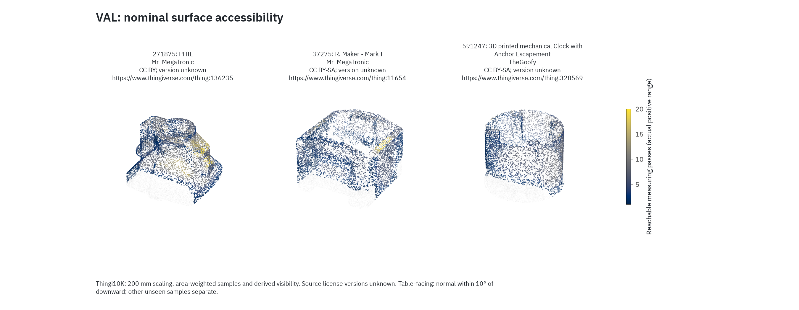
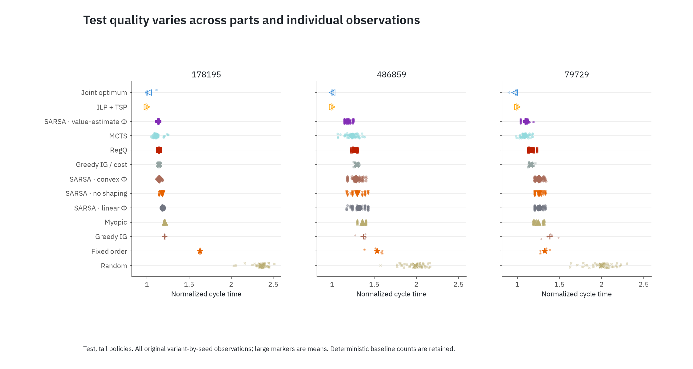
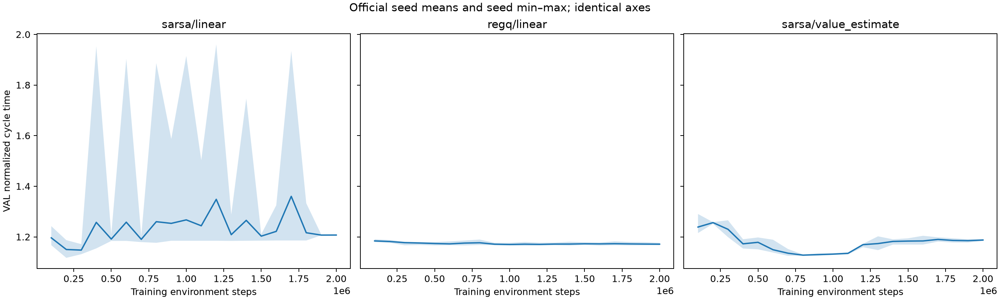
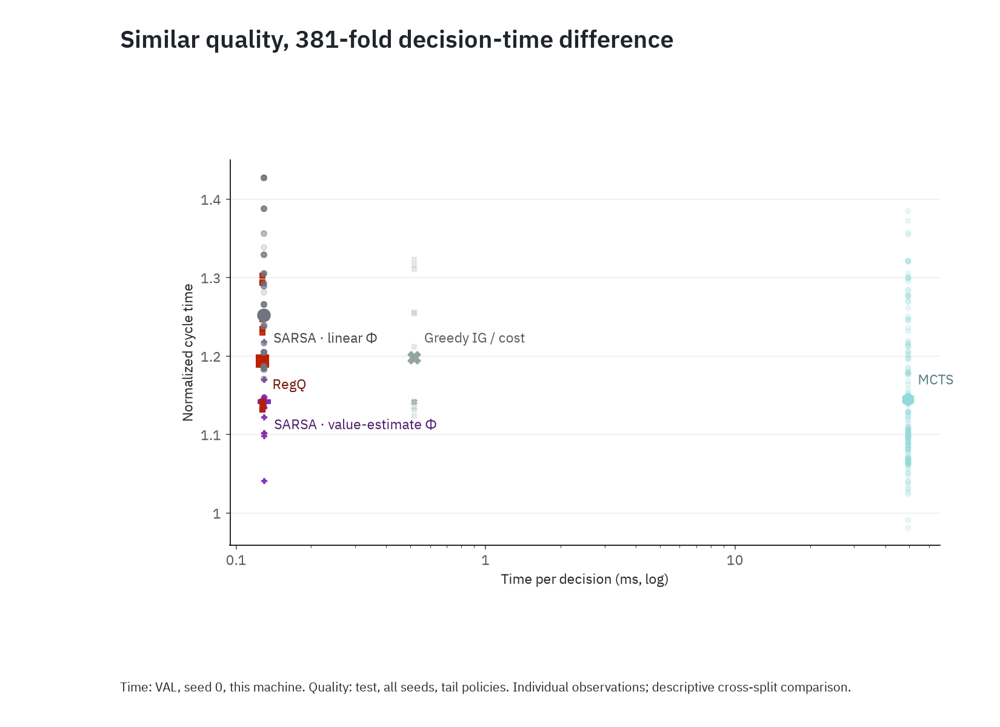
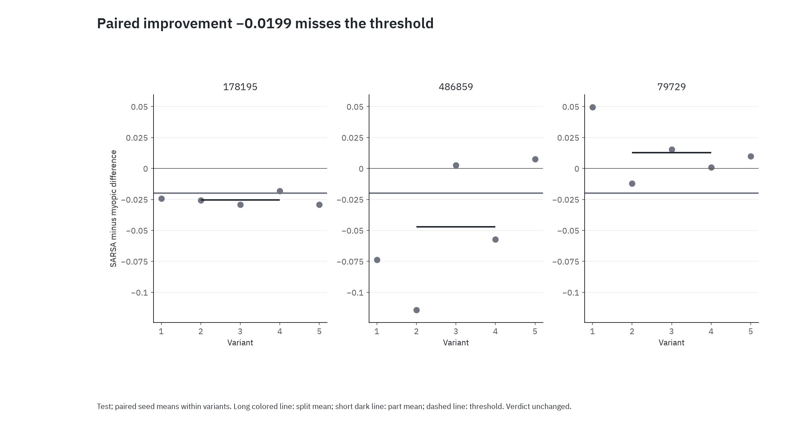

# Robot Koluna Bağlı Çizgi Lazer Profilometreyle Yüzey Taramasında Sonraki En İyi Bakışın Öğrenilmesi

**Yasin Ekici — Bursa Teknik Üniversitesi, Derin Pekiştirmeli Öğrenme dersi**

## Özet

Bu çalışma, nominal CAD modeli bilinen bir parçanın ölçülebilir yüzeyini robot hareketi ve tarama süresini azaltarak kapsama problemini inceler. Çift optik örtülme, robot erişilebilirliği ve statik çarpışma maskeleri içeren benzetimde doğrusal true online SARSA(λ), düzenlileştirilmiş Q-learning ve miyop öğrenme; açgözlü bilgi kazancı, Monte Carlo ağaç araması ve CAD tabanlı planlayıcılarla karşılaştırılmıştır. Eğitim ve ayar işlemlerinden ayrılan 3 test parçasında önceden seçilen doğrusal potansiyelli SARSA'nın normalize çevrim süresi 1,252614, değer tahmini potansiyelli SARSA'nın 1,142396, MCTS'nin 1,144764 olmuştur. Önceden konan hipotez eşikleri sağlanmamıştır. Değer tahmini kolunun MCTS'ye yakın sonucu sonradan gözlenen betimsel bir bulgudur; bu kol testten önce ana yöntem olarak seçilmemiştir. Sonuçlar küçük bir benzetim örneklemine ve tahmini hareket sürelerine aittir; fiziksel çarpışmasız robot performansı iddiası taşımaz.

## 1 Giriş ve motivasyon

Robotlu optik muayenede gereksiz tarama geçişleri çevrim süresini uzatır; iç boşluklar, kaburgalar ve yüzey normalleri bazı bölgeleri belirli bakışlardan görünmez kılar. Sonraki en iyi bakış (NBV) planlama, yeni ölçülebilir alan ile o bakışa erişmenin maliyetini birlikte ele alır. Bu nedenle yalnız bilgi kazancını artırmak, hızlı bir muayene planı üretmeye yetmez.

Çalışma, dersteki Ödev 7 kapsamındadır. Odak, farklı parça türlerine aktarılabilen ve çevrim süresini doğrudan gözeten bir seçim kuralının öğrenilip öğrenilemeyeceğidir. Dersin ara aşaması sinir ağı kullanmadan doğrusal yöntemleri sınar. Böylece temsil öğrenmesine geçmeden önce ortam, güçlü karşılaştırmalar ve değerlendirme tasarımı incelenebilir. Sonuç, kapalı bir test kümesinde yöntem değiştirmek için kullanılmaz.

## 2 İlgili çalışmalar

Bakış planlama literatürü, geometriyi yeniden oluşturma ve muayene için kapsama, görünürlük ve maliyeti bir arada ele alır [1]. Endüstriyel muayenede RL tabanlı görünüm seçimi araştırılmıştır [2]; profilometrik sensör yörüngelerini öğrenen çalışmalar da vardır [3]. Robot simülasyonunu ve kinematik kısıtları planlamaya katmak pratik uygulanabilirlik açısından önemlidir [4]. Bu çalışmaların varlığı, yöntemlerin bütün endüstriyel koşullarda olgunlaştığı anlamına gelmez. Buradaki karşılaştırma, güçlü açgözlü ve çözücü tabanlı referansları aynı maliyet modelinde gösterir.

Öğrenilmiş kombinatoryal sezgiseller güçlü çözücülere yaklaşabilir; çözücü karşılaştırmasının kaldırılması uygun değildir [5]. Klasik zamansal fark öğrenmesi için temel çerçeve [6], çevrim içi iz güncellemeleri için true online yöntemler [7] ve doğrusal Q-learning'in düzenlileştirilmesi için RegQ [8] kullanılmıştır. Yöntemler kaynaklardan uyarlanmıştır; özgün çalışmaların deneylerinin yeniden üretimi iddia edilmez.

## 3 Problem tanımı

### Durum, eylem ve bilgi sınırı

Nominal CAD, aday pasların geometrisini ve nominal görünürlük modelini sağlar. Gerçek varyantın görünürlük matrisi değerlendirmeye ayrılmıştır. Gözlem; ölçülmüş örneklerin bit dizisi, kullanılmış paslar, mevcut eklem durumu, adım sayısı ve nominal kapsama bilgisini içerir. Her eylem, önceden hesaplanmış 48 adaydan bir tarama pasıdır. Kullanılmış, IK ile erişilemeyen veya statik çarpışma maskesine giren eylemler seçilemez.

Bu, bilinen nominal modele dayalı bir problemdir; öğrenici gerçek varyantın tüm geometrisini görmez. Ödevde önerilen sürekli bakış açısı değişimleri burada ayrık pas seçimine dönüştürülmüştür. Sensörün Öklid uzayındaki yolu yerine robotun eklem uzayındaki tahmini süre kullanılır. Bilgi kazancı terimi ortamın ödülüne değil öğrenicinin şekillendirmesine konmuştur.

### Geçiş, ödül ve bölüm sonu

Bir pas tamamlandığında yeni ölçülen örnekler kümeye eklenir, robot pas sonuna gelir ve eylem kullanılmış olur. Bölüm 95% birincil kapsamaya, 24 pas sınırına veya eylemsizliğe ulaşınca biter. Başarısız bitişler sansürlü olarak kaydedilir. Eve dönüş her durumda süreye dahildir.

$$
r_t=-(t_{\mathrm{move},t}+t_{\mathrm{scan},t})
-\mathbf 1_{\mathrm{terminal}}t_{\mathrm{home}}
+B\mathbf 1_{\mathrm{success}},\qquad B=250\ \mathrm{s}.
$$

Dolayısıyla toplam ödül, başarı primi eksi çevrim süresidir. Başarısız bir bölümün kısa sürmesi başarılı bir tarama anlamına gelmez; süre ile başarı birlikte raporlanır.

### Hareket süresi ve ana ölçüt

`robot.movej_time`, lider eklem için simetrik üçgen/trapez profilini kullanır. Eklem sarma ve sınır denetimi yürütülen pasın tamamı üzerinde uygulanır. Aşağıdaki d, seçilmiş uygun eklem temsilleri arasındaki en büyük mutlak değişimdir:

$$
d=\max_j|\Delta q_j|,\qquad
t_{\mathrm{move}}(d)=
\begin{cases}
2\sqrt{d/a},&d<v^2/a,\\
d/v+v/a,&d\geq v^2/a.
\end{cases}
$$

Hız sınırı 1,05 rad/s, ivme sınırı 1,4 rad/s² ve tarama hızı 100 mm/s'dir. Ana karşılaştırma, aynı varyanttaki yürütülmüş ILP + TSP süresine göre yapılır:

$$
\widetilde T_{m,p,v,s}
=\frac{T_{m,p,v,s}}{T_{\mathrm{ILP+TSP},p,v}},\qquad
T=\sum_t(t_{\mathrm{move},t}+t_{\mathrm{scan},t})+t_{\mathrm{home}}.
$$

Pay ve payda aynı aday kümesini kullanır; onarım pasları da dahildir. Parça ortalamaları eşit ağırlıklıdır. Ham saniyeler ayrıca verilir. Referansın bir olması, onun gerçek dünyada küresel optimum olduğunu göstermez.

## 4 Yöntem

### Doğrusal değer yaklaşımı

$$
Q_w(s,a)=w^\top\varphi(s,a).
$$

Seçilen 11 bileşen sırasıyla sabit terim, nominal yeni kapsama, en iyi kazanca göre göreli kazanç, hareket süresi, tarama süresi, göreli kazanç/süre, hedefi bitirme göstergesi, eve dönüş süresi, kalan nominal pay, hedef için gereken pay ve bölüm ilerlemesidir. Normalleştirme parça üzerinde öğrenilmiş istatistik kullanmaz. Zamanlar sabit bir ölçeğe, oranlar o durumdaki adaylara göre ifade edilir. İskonto 1,0; öğrenici tarafındaki ödül ve potansiyel ölçeği 0,01 olarak sabittir.

Başlangıçtaki daha geniş temsil, eğitimde öğrenilip doğrulamada ölçülen önceden tanımlı çıkar-ve-karşılaştır kontrolüyle daraltılmıştır. Sabit terim ve yalnız duruma bağlı bileşenler bütün eylemlere aynı değeri ekler. Böylece eylem sıralamasını esas olarak sabit ağırlıklı pas puanları belirler; zengin durum–eylem etkileşimleri temsil edilmez.

### Güncellemeler

True online SARSA(λ), ε-açgözlü davranış politikası ve dutch izleriyle çevrim içi ileri görünümü izler [7]. Şekillendirilmiş ve ölçeklenmiş ödül \(\widetilde r_t\) için SARSA hedefi:

$$
y_t^{\mathrm{SARSA}}=\widetilde r_t+\gamma Q_w(s_{t+1},a_{t+1}).
$$

RegQ, aynı doğrusal temsilde maksimum sonraki değeri kullanır ve ağırlıklara L2 düzenlileştirme uygular [8]:

$$
y_t^{\mathrm{RegQ}}=\widetilde r_t+\gamma\max_{a\in\mathcal A(s_{t+1})}Q_w(s_{t+1},a),\qquad
w\leftarrow w+\alpha\big[(y_t-Q_w(s_t,a_t))\varphi(s_t,a_t)-\eta w\big].
$$

Miyop öğrenici sonraki değere önyükleme yapmaz; aynı tek-adım şekillendirilmiş ödüle regresyon uygular:

$$
y_t^{\mathrm{miyop}}=\widetilde r_t,\qquad
w\leftarrow w+\alpha(y_t-Q_w(s_t,a_t))\varphi(s_t,a_t).
$$

Terminal durumlarda bütün önyükleme terimleri sıfırdır. Miyop hedefi yalnız hızdan oluşmaz: potansiyel farkı kapsama kazanımını da taşır. Böylece gecikmiş değer öğrenmenin katkısı araştırılabilir.

### Potansiyel tabanlı şekillendirme

PBRS, potansiyel farkı ekleyerek hedef politikayı korumayı amaçlar [9]. Bölümlü durumda terminal potansiyelin sıfır olması önemlidir [10]:

$$
F_t=\gamma\Phi(s_{t+1})-\Phi(s_t),\qquad
\sum_{t=0}^{T-1}\gamma^tF_t=-\Phi(s_0)+\gamma^T\Phi(s_T).
$$

Terminal potansiyel sıfırlanır. C nominal erişilebilir birleşimde ölçülen pay olmak üzere potansiyeller: sıfır; 50,0C; 50,0C²; nominal açgözlü planın tahmini kalan hareket/tarama/eve dönüş süresinin negatifi. Sonuncusu gelecekteki kalan maliyet için bir sezgiseldir. Sabit pozitif ödül ölçeklemesi bütün öğrenenlerde aynıdır.

Doğrusal potansiyel bu öznitelik uzayında temsil edilebilir; uygun başlangıç ağırlıklarıyla şekillendirmesiz öğrenmeye eşdeğerlik, Wiewiora'nın sonucu ile uyumludur [11]. Bu karşılaştırma farklı başlangıç değerlerini de karşılaştırır. İlke, her potansiyelin daha hızlı öğrenmesini garanti etmez.

### Karşılaştırma yöntemleri

Greedy-IG/maliyet, nominal yeni ölçüm sayısını hareket ve tarama süresine böler. MCTS, nominal modelde UCT araması yapar [12]. ILP + TSP önce kapsama için pas kümesini, sonra turu seçer. Ortak planlayıcı pas seçimiyle sıralamayı birlikte çözer. Son ikisi nominal planı yürütür; hedef eksik kalırsa aynı nominal açgözlü kural ile onarır. Ortak planlayıcı gerçek varyantı bilen bir oracle değildir. Rastgele, sabit desen ve yalnız bilgi kazancı yardımcı karşılaştırmalardır.

## 5 Deney düzeni

### Veri, sensör ve robot hücresi

Thingi10K'dan [13] alınan 14 mekanik model, döküm parçaya benzer geometrilerin vekilidir; gerçek döküm taraması veri kümesi değildir. Bölme parça türüne göredir: 8 eğitim, 3 doğrulama, 3 test. Her parçanın 5 geometrik varyantı aynı bölmede kalır. Nominal mesh bilinir; küçük üretim sapmaları gerçek varyantta uygulanır.

İdeal çizgi lazerin çalışma mesafesi 200 mm, çizgi uzunluğu 100 mm ve triangülasyon açısı 25 derecedir. Görünürlük hem lazer hem kamera yolunun açık olmasını gerektirir. UR5'in sensör ofseti 120,0 mm'dir. Erişilebilirlik ve statik çarpışma, her pasta 5 IK örneğinde kontrol edilir. Erişilebilir yüzey tüm yüzeyin bir alt kümesidir; masaya bakan ve optik olarak kapalı bölgeler hedef paydasına alınmaz. Kayıtlı ortalama erişilebilir ham yüzey payı doğrulamada 33.85%, testte 33.83% düzeyindedir.



**Şekil 1.** Doğrulama parçalarında görünürlük dağılımı. Renk erişilebilir pas sayısını; ayrı sınıflar hiç görülemeyen ve masaya bakan örnekleri gösterir. Yüksek birincil kapsama, bütün fiziksel yüzeyin ölçüldüğü anlamına gelmez.

### Ön kayıt, ayar ve testin ayrılması

Ana yöntem, hipotezler, eşikler, bütçeler ve seçim kuralları testten önce yazılmıştır. Ayrıntılar [Ek: Ön kayıt ve değerlendirme protokolü](docs/PROTOCOL.md) belgesindedir. Ayar seed'leri resmi değerlendirme seed'lerinden ayrılmış, yöntemlere eşit arama bütçesi verilmiştir. Bu ayrım, ayar rastlantılarına aşırı uyumu azaltmak için önemlidir [14] [15].

6 resmi kolun her biri 10 seed ile 2000000 adım eğitilmiştir. Her öğrenenin resmi politikası eğitimin son yüzde onundaki sonlu ağırlıkların ortalamasıdır. Son ağırlıklarla değerlendirme ikincildir; checkpoint seçimi yapılmamıştır. Seçilen ayarlar:

| Yöntem | Etkin adım | İz / düzenlileştirme | Keşif |
|---|---:|---|---|
| SARSA(λ) | 0,002727273 | λ = 0,5 | Sabit ε = 0,05 |
| RegQ | 0,010000000 | η = 0,001 | Sabit ε = 0,05 |
| Miyop öğrenici | 0,030000000 | Önyükleme yok | Sabit ε = 0,05 |

Test açılışının ilk girişimi eksik bir nominal yardımcı girdinin hash kontrolünde, herhangi bir ortam veya performans hesabından önce durmuştur. Girdi tamamlanıp kontroller geçtikten sonra tek bir yetkilendirilmiş devam yapılmış; tamamlanan test kümesi kapatılmıştır. Yöntem, ayar ve hipotezler bu olay nedeniyle değiştirilmemiştir. Bu koruma, holdout'un performansa bakılarak uyarlamalı kullanılmasını engeller [16].

### İstatistik

İstatistiksel birim parçadır. Önce her test parçası; sonra parçalar, varyantlar ve seed'ler üzerinden hiyerarşik bootstrap aralığıyla bölme ortalaması verilir [17]. Özgün aralık hesabı 10000 tekrar kullanmıştır. Aralıklar mevcut kayıtlı uç değerlerden alınır; bu rapor için yeniden örnekleme yapılmaz. Varyant ve seed sayıları bağımsız parça sayısını artırmaz. Anlamlılık testi yoktur; bütün karşılaştırmalar betimseldir.

## 6 Sonuçlar

### Parça bazında birincil test sonuçları

Tablolarda nokta tahmini ve kayıtlı aralık gösterilir. Küçük normalize süre daha iyidir; başarısız bölümlerin süreleri de ortalamada tutulmuştur. Başarı sütunu bu yüzden zorunludur. Ortak planlayıcının adı, yürütülmüş gerçek-varyant süresinin kesin optimum olduğu anlamına gelmez.

#### Test parçası 79729

| Yöntem | Normalize süre | Süre (s) | Başarı |
|---|---:|---:|---:|
| SARSA · doğrusal potansiyel (ana yöntem) | 1,257814 [1,217370; 1,297736] | 54,986117 [53,505852; 56,749959] | 1,000000 [1,000000; 1,000000] |
| RegQ | 1,165539 [1,132553; 1,205877] | 50,935974 [50,401758; 51,976335] | 1,000000 [1,000000; 1,000000] |
| Miyop öğrenici | 1,245104 [1,197441; 1,293176] | 54,412642 [53,234035; 56,222251] | 1,000000 [1,000000; 1,000000] |
| SARSA · şekillendirme yok | 1,257609 [1,216998; 1,297222] | 54,971443 [53,665141; 56,554169] | 1,000000 [1,000000; 1,000000] |
| SARSA · dışbükey potansiyel | 1,253761 [1,217195; 1,292388] | 54,796221 [53,854014; 55,954532] | 1,000000 [1,000000; 1,000000] |
| SARSA · değer tahmini | 1,100304 [1,073538; 1,120119] | 48,111558 [46,827659; 49,238905] | 1,000000 [1,000000; 1,000000] |
| Rastgele | 1,999510 [1,940781; 2,069173] | 87,382169 [85,545014; 88,950432] | 0,180000 [0,080000; 0,320000] |
| Sabit desen | 1,323018 [1,286386; 1,359651] | 57,827990 [56,664780; 58,991199] | 1,000000 [1,000000; 1,000000] |
| Greedy-IG | 1,386395 [1,328673; 1,442429] | 60,626386 [57,970928; 63,565177] | 1,000000 [1,000000; 1,000000] |
| Greedy-IG/maliyet | 1,159874 [1,129566; 1,192771] | 50,700125 [49,883728; 51,947853] | 1,000000 [1,000000; 1,000000] |
| ILP + TSP | 1,000000 [1,000000; 1,000000] | 43,744924 [42,308537; 44,502867] | 1,000000 [1,000000; 1,000000] |
| MCTS | 1,087017 [1,059167; 1,116187] | 47,534583 [46,097877; 49,082536] | 1,000000 [1,000000; 1,000000] |
| Ortak planlayıcı | 0,966629 [0,932657; 0,985093] | 42,274494 [40,787891; 43,761096] | 1,000000 [1,000000; 1,000000] |

#### Test parçası 178195

| Yöntem | Normalize süre | Süre (s) | Başarı |
|---|---:|---:|---:|
| SARSA · doğrusal potansiyel (ana yöntem) | 1,184913 [1,184182; 1,186376] | 56,872825 [56,837716; 56,943043] | 1,000000 [1,000000; 1,000000] |
| RegQ | 1,141931 [1,141931; 1,141931] | 54,809778 [54,809778; 54,809778] | 1,000000 [1,000000; 1,000000] |
| Miyop öğrenici | 1,210242 [1,207579; 1,212757] | 58,088539 [57,960739; 58,209240] | 1,000000 [1,000000; 1,000000] |
| SARSA · şekillendirme yok | 1,177397 [1,168581; 1,184182] | 56,512082 [56,088921; 56,837716] | 1,000000 [1,000000; 1,000000] |
| SARSA · dışbükey potansiyel | 1,144466 [1,141931; 1,147846] | 54,931454 [54,809778; 55,093689] | 1,000000 [1,000000; 1,000000] |
| SARSA · değer tahmini | 1,136116 [1,134279; 1,138564] | 54,530674 [54,442536; 54,648191] | 1,000000 [1,000000; 1,000000] |
| Rastgele | 2,354661 [2,322214; 2,381593] | 113,017743 [111,460410; 114,310436] | 0,160000 [0,060000; 0,300000] |
| Sabit desen | 1,629178 [1,629178; 1,629178] | 78,196428 [78,196428; 78,196428] | 1,000000 [1,000000; 1,000000] |
| Greedy-IG | 1,209765 [1,209559; 1,210178] | 58,065677 [58,055774; 58,085483] | 1,000000 [1,000000; 1,000000] |
| Greedy-IG/maliyet | 1,141931 [1,141931; 1,141931] | 54,809778 [54,809778; 54,809778] | 1,000000 [1,000000; 1,000000] |
| ILP + TSP | 1,000000 [1,000000; 1,000000] | 47,997466 [47,997466; 47,997466] | 1,000000 [1,000000; 1,000000] |
| MCTS | 1,111457 [1,098228; 1,127849] | 53,347102 [52,712169; 54,133877] | 1,000000 [1,000000; 1,000000] |
| Ortak planlayıcı | 1,019429 [0,996743; 1,064801] | 48,930014 [47,841137; 51,107769] | 1,000000 [1,000000; 1,000000] |

#### Test parçası 486859

| Yöntem | Normalize süre | Süre (s) | Başarı |
|---|---:|---:|---:|
| SARSA · doğrusal potansiyel (ana yöntem) | 1,315115 [1,247102; 1,382704] | 74,530415 [70,911354; 77,740877] | 1,000000 [1,000000; 1,000000] |
| RegQ | 1,273295 [1,246287; 1,297116] | 72,254465 [69,477010; 75,685452] | 1,000000 [1,000000; 1,000000] |
| Miyop öğrenici | 1,362181 [1,329794; 1,391933] | 77,271683 [74,461215; 80,384155] | 1,000000 [1,000000; 1,000000] |
| SARSA · şekillendirme yok | 1,297363 [1,231420; 1,364070] | 73,506847 [70,432344; 76,530935] | 1,000000 [1,000000; 1,000000] |
| SARSA · dışbükey potansiyel | 1,285247 [1,226971; 1,336394] | 72,801747 [71,177257; 74,579291] | 1,000000 [1,000000; 1,000000] |
| SARSA · değer tahmini | 1,190768 [1,152126; 1,229411] | 67,604202 [64,139770; 72,047046] | 1,000000 [1,000000; 1,000000] |
| Rastgele | 1,984765 [1,911711; 2,045270] | 112,458181 [110,036121; 114,295778] | 0,060000 [0,000000; 0,160000] |
| Sabit desen | 1,532809 [1,450258; 1,591538] | 86,794939 [84,987660; 88,602218] | 1,000000 [1,000000; 1,000000] |
| Greedy-IG | 1,368802 [1,321046; 1,394307] | 77,551325 [77,389884; 77,661659] | 1,000000 [1,000000; 1,000000] |
| Greedy-IG/maliyet | 1,292478 [1,266633; 1,318323] | 73,347479 [70,514458; 76,889574] | 1,000000 [1,000000; 1,000000] |
| ILP + TSP | 1,000000 [1,000000; 1,000000] | 56,729533 [55,670810; 58,846979] | 1,000000 [1,000000; 1,000000] |
| MCTS | 1,235818 [1,192307; 1,275255] | 70,040514 [68,190187; 71,839262] | 1,000000 [1,000000; 1,000000] |
| Ortak planlayıcı | 1,000519 [0,998715; 1,004129] | 56,766642 [55,599258; 59,101410] | 1,000000 [1,000000; 1,000000] |



**Şekil 2.** Her test parçasında varyant × seed gözlemleri. Deterministik karşılaştırmaların gerçek gözlem sayısı korunur; fazladan örnek çoğaltılmaz.

### Bölme ortalaması: ikincil özet

| Yöntem | Normalize süre | Süre (s) | Başarı |
|---|---:|---:|---:|
| SARSA · doğrusal potansiyel (ana yöntem) | 1,252614 [1,185151; 1,318327] | 62,129786 [55,000528; 74,070774] | 1,000000 [1,000000; 1,000000] |
| RegQ | 1,193588 [1,141931; 1,270211] | 59,333406 [50,942590; 71,770681] | 1,000000 [1,000000; 1,000000] |
| Miyop öğrenici | 1,272509 [1,209995; 1,358423] | 63,257622 [54,542876; 76,878225] | 1,000000 [1,000000; 1,000000] |
| SARSA · şekillendirme yok | 1,244123 [1,178526; 1,305245] | 61,663457 [54,927680; 73,080901] | 1,000000 [1,000000; 1,000000] |
| SARSA · dışbükey potansiyel | 1,227824 [1,144747; 1,291675] | 60,843141 [54,536238; 72,572630] | 1,000000 [1,000000; 1,000000] |
| SARSA · değer tahmini | 1,142396 [1,101418; 1,189185] | 56,748811 [48,264736; 67,037517] | 1,000000 [1,000000; 1,000000] |
| Rastgele | 2,112979 [1,965314; 2,351121] | 104,286031 [87,582029; 113,454593] | 0,133333 [0,053333; 0,226667] |
| Sabit desen | 1,495002 [1,328961; 1,629178] | 74,273119 [58,021858; 86,541316] | 1,000000 [1,000000; 1,000000] |
| Greedy-IG | 1,321654 [1,209834; 1,399632] | 65,414463 [58,065677; 77,531582] | 1,000000 [1,000000; 1,000000] |
| Greedy-IG/maliyet | 1,198094 [1,141931; 1,288913] | 59,619127 [50,879515; 72,874528] | 1,000000 [1,000000; 1,000000] |
| ILP + TSP | 1,000000 [1,000000; 1,000000] | 49,490641 [43,979684; 56,376625] | 1,000000 [1,000000; 1,000000] |
| MCTS | 1,144764 [1,084881; 1,230727] | 56,974066 [47,678960; 69,819031] | 1,000000 [1,000000; 1,000000] |
| Ortak planlayıcı | 0,995526 [0,966196; 1,026991] | 49,323717 [42,522261; 56,377514] | 1,000000 [1,000000; 1,000000] |

Önceden seçilen ana yöntem, doğrusal potansiyelli SARSA'dır. Değer tahmini potansiyelli kol testte en iyi SARSA sonucu vermiştir; bu durum ana yöntem seçiminde kullanılmamıştır. MCTS'ye yakın ortalamalar, istatistiksel eşdeğerlik veya fiziksel uygulanabilirlik kanıtı değildir.

### Öğrenme eğrileri ve bölmeler arası tutarlılık



**Şekil 3.** SARSA, RegQ ve değer tahmini kolunun doğrulama öğrenme eğrileri: seed ortalaması ve seed min–maks aralığı. Bantlar güven ya da bootstrap aralığı değildir.

| SARSA potansiyeli | Eğitim | Doğrulama | Test |
|---|---:|---:|---:|
| Doğrusal | 1,196642 | 1,207170 | 1,252614 |
| Yok | 1,196512 | 1,206435 | 1,244123 |
| Dışbükey | 1,198637 | 1,198957 | 1,227824 |
| Değer tahmini | 1,162074 | 1,187515 | 1,142396 |
| MCTS | 1,094257 | 1,104443 | 1,144764 |

Değer tahmini kolu eğitim, doğrulama ve testte en düşük SARSA ortalamasına sahiptir. Bu tutarlılık betimsel bulguyu destekler; bağımsız bir tekrar deneyinin yerini tutmaz. Genelleme açığı eğitim eksi test olarak tanımlanır; parçaların zorluk dağılımları ve normalizasyon nedeniyle işareti tek başına aşırı öğrenme tanısı değildir.

Normalize sürede eğitim eksi test farkı ana SARSA için -0,055972, değer tahmini kolu için 0,019679 olmuştur.

### Karar başına planlama süresi

| Politika | Ortalama ms/karar | Medyan ms | Karar sayısı |
|---|---:|---:|---:|
| Greedy-IG/maliyet | 0,516845 | 0,508500 | 567 |
| MCTS | 49,265584 | 44,271900 | 567 |
| RegQ | 0,127334 | 0,125000 | 567 |
| SARSA · doğrusal potansiyel (ana yöntem) | 0,128641 | 0,124300 | 567 |
| SARSA · değer tahmini | 0,129405 | 0,126400 | 567 |

Süreler aynı doğrulama durumlarında, seed sıfır politikalarıyla, sıcak önbellekte ve bu makinede ölçülmüştür. Öznitelik hesabı/eylem seçimi veya nominal MCTS dahildir; ortam adımı, ön işleme, önbellek yükleme ve eğitim potansiyeli hesabı hariçtir. Değer tahmini potansiyeli öğrenme sırasında kullanılır; donmuş doğrusal politikanın çıkarımında yeniden hesaplanmaz. Bu ölçümde MCTS / değer tahminli SARSA süre oranı 380,7 kattır; evrensel donanım bağımsız bir hızlanma iddiası değildir.



**Şekil 4.** Kalite test kayıtlarından, süre doğrulama üzerindeki seed-sıfır ölçümünden gelir. Bölmeler arası bu görünüm betimseldir.

## 7 Tartışma

**H1′:** Ana SARSA'nın açgözlü yöntem ile ILP + TSP arasındaki boşluğun en az yarısını kapatması beklenmişti. Parça eşiği açgözlü normalize sürenin bir ile ortalamasıdır; hem bölme koşulu hem test parçalarının çoğunun kendi eşiğini sağlaması gerekir. Önceden konan koşullar sağlanmadı. Bazı parçalarda boşluk kapanmak yerine büyümüştür; sonuçlar kesilmeden raporlanmıştır.

**H-ileri görüş:** Ön kayıt en az 0,02 ortalama iyileşme ve test parçalarının çoğunda negatif eşleştirilmiş fark ister. SARSA eksi miyop eşleştirilmiş farkı -0,019894820622543344. Gerekli iyileşmeye eksik kalan pay 0,000105179377457 olduğundan eşik sağlanmadı. Küçük farkı yuvarlayıp başarılı saymak uygun değildir. Bu sonuç iki politikanın eşdeğer olduğunu kanıtlamaz.

| Test parçası | H1′ eşiği | Kapanan boşluk payı | SARSA − MCTS | SARSA − miyop |
|---|---:|---:|---:|---:|
| 486859 | 1,146239 | -0,077399 | 0,079297 | -0,047066 |
| 178195 | 1,070965 | -0,302841 | 0,073456 | -0,025329 |
| 79729 | 1,079937 | -0,612603 | 0,170797 | 0,012710 |



**Şekil 5.** Varyantlarda seed ortalaması alındıktan sonraki eşleştirilmiş farklar. Parça ve bölme ortalamaları, sıfır çizgisi ve önceden tanımlanan iyileşme eşiği birlikte gösterilir.

**H-şekillendirme:** Hız için en az 10% öğrenme alanı farkı ve her potansiyel için doğrusal kola göre en fazla 0,02 nihai fark istenir. Doğrulama öğrenme alanının en iyi–en kötü göreli farkı 7,111808% olmuştur. Her iki koşulu isteyen birleşik eşik sağlanmadı. Bu, potansiyel şekillendirmenin politikayı koruma özelliğiyle çelişmez; sonlu temsil, başlangıç değerleri ve öğrenme dinamikleri performansı etkiler.

| Potansiyel | Doğrulama öğrenme alanı | Test süresi − doğrusal |
|---|---:|---:|
| Doğrusal | 2345030,439799 | 0,000000 |
| Yok | 2389857,477368 | -0,008491 |
| Dışbükey | 2325504,372596 | -0,024790 |
| Değer tahmini | 2231180,231636 | -0,110218 |

Doğrusal SARSA'nın salınması literatürde bilinen bir davranıştır [18]. Son ağırlıklarla kuyruk ortalamasının ayrılması bu açıklamayla uyumludur; nedensel kanıt değildir. Ayrıca en iyi ayar tahminini seçmek iyimserlik üretir [19]. Ayardan önce yazılan küçük ileri-görüş farkı tahmini resmi doğrulamayla uyumluyken, ayar sonrasındaki büyük-fark yorumu uyumlu olmamıştır. İki açıklama birlikte bulunabilir.

RegQ resmi koşularda ampirik olarak kararlı kalmıştır. Kullanılan kimlik-matrisli düzenlileştirme için yeterli yakınsama koşulu değerlendirilmemiştir. Farklı bir eski formüle dayanarak teorik garanti iddia edilmez.

Değer tahmini kolunun olası avantajı, doğrusal temsilin büyük duruma bağlı değer değişimlerini öğrenme yükünü azaltması olabilir. Bu açıklama doğrulanmamıştır; sezgisel değerle yönlendirme [20], değer/avantaj ayrımı [21] ve iyi potansiyel seçimi [22] ile ilişkilidir. Daha iyi görünen test kolunu sonradan seçmenin iyimserlik riski vardır; üç bölmedeki tutarlılık bu riski tamamen kaldırmaz.

## 8 Sınırlılıklar

İdeal sensör modeli ölçümü ikili kabul eder. Yansıma, speckle, parlak yüzeyde çoklu yansıma, çizgi uçlarının doğruluk kaybı ve ölçüm gürültüsü modellenmez. Tek kurulum ve döner tabla olmaması iç veya masaya bakan yüzeyleri erişilemez bırakır. Veri işleme, kayıt ve CAD karşılaştırması süreye dahil değildir.

Beş örnek pozundaki statik çarpışma denetimi, pozlar arası yolu güvenli yapmaz. Sonradan kayıtlı eğitim/doğrulama yollarında yapılan yoğun örneklemeli denetim şu oranları vermiştir:

| Yöntem | VAL çarpışan geçiş | Train çarpışan geçiş |
|---|---:|---:|
| Greedy-IG/maliyet | 9,80% | 6,81% |
| MCTS | 5,60% | 7,81% |
| ILP + TSP | 0,00% | 0,22% |
| Ortak planlayıcı | 0,00% | 0,22% |
| SARSA · doğrusal potansiyel (ana yöntem) | 11,37% | 9,66% |
| SARSA · değer tahmini | 7,37% | 6,35% |
| RegQ | 10,80% | 7,90% |
| Miyop öğrenici | 10,34% | 12,62% |

Aynı sarılmamış uç noktalar, başlangıç/sonda duruş ve hız/ivme sınırları altında doğrudan eklem hareketinin süresi, çarpışmasız dolambaçlı bir yol için alt sınırdır. Kaçınma süresi ölçülmediği için kayıtlı süreler fiziksel uygulama açısından iyimser olabilir. CAD planlayıcılarında oranların düşük olması sınırlılığın yöntemleri aynı ölçüde etkilemediğini gösterir; düzeltilmiş bir sıralama veya bütün hipotezlerin sağlamlığı kanıtlanmaz. Değer tahminli SARSA–MCTS yakınlığı bu belirsizlik içindedir. Test parçalarında bu denetim yapılmamıştır.

Öz-çarpışma ve fikstürler modellenmez; örneklenmiş güvenli durumlar sürekli yol sertifikası değildir. 2400 ikincil son-ağırlık eğitim bölümü çarpışma açısından ölçülmemiştir. Öğrenenlerin test adım izleri saklanmadığından bağımsız doğrulama politika tekrarından çok kayıt/metrik tutarlılığını denetlemiştir.

Örneklem azdır; başarı yüzey alanının tamamına göre değil erişilebilir birleşime göredir. Adım ölçeği yöntemler arasında asimetriktir. Potansiyeller ayrı ayrı ayarlanmamıştır. Kamera-only karşılaştırması betimseldir. Parça lisanslarının sürüm doğrulaması erişim engeli nedeniyle tamamlanamamıştır.

## 9 Gelecek çalışma

Öncelik, geri çekilme ara pozları ve daha sık yol denetimiyle çarpışmasız geçiş modelidir. Hareket matrisi değişirse karşılaştırmaların tamamı yeni bir değerlendirme tasarımıyla yeniden üretilmelidir; mevcut kapalı test kümesi uyarlamalı seçime açılmaz.

Sonraki öğrenme aşaması durum–eylem etkileşimlerini öğrenen maskeli derin yöntemleri inceleyebilir. Değer/avantaj ayrımı, sezgisel değerle ufuk kısaltma ve bir açgözlü/arama politikasının üzerine artık politika öğrenme seçeneklerdir [23]. Bu yaklaşımlar henüz burada uygulanmamıştır. Değer tahmini açıklaması da kontrollü olarak sınanmalıdır.

## 10 Yeniden üretim

Python 3.14, uv ve Windows/PowerShell kullanılmıştır. Kayıtlı makine bilgisi: Intel Core Ultra 9 275HX, 24 çekirdek; RTX 5080 Laptop, 16 GB; Windows. Sayısal iş parçacığı değişkenleri kullanıcı tarafından verilmemişse birle sınırlandırılır. GPU, bu doğrusal yöntemler için gerekli değildir. Kaydedilmiş resmi ve keşif eğitim grubunun toplam duvar süresi 20 süreçte 1,344 saattir; bu süre veri hazırlığı, kurulum veya başka donanımın maliyeti değildir.

### Kısa ve güvenli doğrulama

Depo kökünde:

```powershell
uv sync --locked --extra demo
uv run --extra demo python scripts/verify_readme.py
uv run --extra demo pytest -q
```

Rapor doğrulayıcı mevcut kayıt ve çıktı dosyalarını okur; eğitim, politika değerlendirmesi veya bootstrap yeniden örneklemesi yapmaz. Kaynak klonda bulunmayan özgün deney önbelleklerine bağımlı bütünleştirme kontrolleri atlanır. Bu, test kümesini yeniden açmak için bir komut değildir.

### Taşınabilir kayıtlı oynatıcı

```powershell
uv run --extra demo python scripts/live_demo.py --recorded --port 8080
```

Tarayıcıda `http://127.0.0.1:8080` açılır. Kayıtlı oynatıcı, paket dosyalarını SHA-256 ile doğrular; özgün mesh, görünürlük önbelleği, checkpoint veya yeni politika çağrısı gerektirmez. Yalnız doğrulama parçalarının kayıtlı bölümlerini gösterir. Başlat, Adım ve Sıfırla kontrolleriyle eve dönüş dahil oynatılır. [Görüntüleyici kılavuzu](docs/DEMO_GUIDE.md).

### Canlı modun ek önkoşulları

```powershell
uv run --extra demo python scripts/live_demo.py --weights weights/linear_learners.json --port 8080
```

Canlı mod ayrıca özgün doğrulama görünürlük/robot önbelleklerini ve kayıtlı doğrulama bölümlerini gerektirir. Bunlar kaynak depoyla dağıtılmaz; ağırlık dosyası tek başına bu girdileri sağlamaz. Girdiler yoksa kayıtlı mod kullanılır. Test parçaları kod düzeyinde reddedilir. ILP + TSP ve ortak planlayıcı yeniden çözülmez; kayıtlı dizileri oynatılır. Bölüm sonunda pas dizisi ve özetler özgün doğrulama kaydıyla birebir karşılaştırılır; uyuşmazlık gizlenmez.

Paylaşılan metin dosyası yalnız kuyruk ortalamalarını içerir: 6 kol × 10 seed, her biri 11 ağırlık; 41767 bayt. Özgün checkpoint'lerle tam hassasiyetli eşleşmesi kontrol edilmiştir. SHA-256:

```text
21f304502f3414aa28f1df42b68347436e6055714f2e50081361fc12d6d10bd4
```

Son ağırlıklar bu dosyada yoktur. Dosyadan yüklenen bir politika tek bir doğrulama bölümüyle özgün kayda karşı kontrol edilmiştir; test değerlendirmesi yapılmamıştır. Görüntüleme sırasında ölçülen karar süreleri, yukarıdaki ayrı sıcak-önbellek benchmark'ıyla aynı koşulları taşımaz.

## 11 Veri ve lisans atıfları

Proje kodu [MIT lisansı](LICENSE) altındadır. Üçüncü taraf robot ve font varlıkları kendi BSD-3-Clause ve OFL lisanslarını; parça ve türetilmiş veriler kendi Creative Commons koşullarını korur. Kodun MIT olması veri varlıklarını MIT yapmaz.

Tablodaki lisans aileleri kayıtlı veri metadatasından gelir. Kaynak sayfalar tek tek kontrol edilmeye çalışılmış, erişim engeli nedeniyle sürüm bilgisi doğrulanamamıştır. Bu nedenle “kaynak sayfada sürüm belirtilmemiş” sonucu çıkarılmamış ve sürüm tahmin edilmemiştir.

| Parça | Yazar | Bölme | Kayıtlı lisans ailesi | Sürüm / kaynak | Değişiklikler |
|---|---|---|---|---|---|
| PHIL | Mr_MegaTronic | Doğrulama | CC BY | [Kaynak sayfa okunamadı; sürüm doğrulanamadı](https://www.thingiverse.com/thing:136235) | Ölçekleme, hizalama, örnekleme ve varyantlar; görünürlük türevi ve sadeleştirilmemiş gösterim mesh’i |
| PrintrBot Clone | PacManFan | Eğitim | CC BY-SA | [Kaynak sayfa okunamadı; sürüm doğrulanamadı](https://www.thingiverse.com/thing:14130) | Ölçekleme, hizalama, örnekleme ve varyantlar; ham mesh dağıtılmıyor |
| VEND - the totally printed candy dispenser | Mr_MegaTronic | Eğitim | CC BY | [Kaynak sayfa okunamadı; sürüm doğrulanamadı](https://www.thingiverse.com/thing:45347) | Ölçekleme, hizalama, örnekleme ve varyantlar; ham mesh dağıtılmıyor |
| Dremel Devil | MAKE | Test | CC BY | [Kaynak sayfa okunamadı; sürüm doğrulanamadı](https://www.thingiverse.com/thing:266035) | Ölçekleme, hizalama, örnekleme ve varyantlar; ham mesh dağıtılmıyor |
| Turbine Rotary Tool 60000 rpm | RichMac | Test | CC BY | [Kaynak sayfa okunamadı; sürüm doğrulanamadı](https://www.thingiverse.com/thing:76369) | Ölçekleme, hizalama, örnekleme ve varyantlar; ham mesh dağıtılmıyor |
| RAPIRO - The Humanoid Robot for your Raspberry Pi | ShotaIshiwatari | Eğitim | CC BY | [Kaynak sayfa okunamadı; sürüm doğrulanamadı](https://www.thingiverse.com/thing:309466) | Ölçekleme, hizalama, örnekleme ve varyantlar; ham mesh dağıtılmıyor |
| R. Maker - Mark I | Mr_MegaTronic | Doğrulama | CC BY-SA | [Kaynak sayfa okunamadı; sürüm doğrulanamadı](https://www.thingiverse.com/thing:11654) | Ölçekleme, hizalama, örnekleme ve varyantlar; görünürlük türevi ve sadeleştirilmemiş gösterim mesh’i |
| 3D printed mechanical Clock with Anchor Escapement | TheGoofy | Doğrulama | CC BY-SA | [Kaynak sayfa okunamadı; sürüm doğrulanamadı](https://www.thingiverse.com/thing:328569) | Ölçekleme, hizalama, örnekleme ve varyantlar; görünürlük türevi ve sadeleştirilmemiş gösterim mesh’i |
| Functional Differential Gear System | Thing-O-Fun | Eğitim | CC BY-SA | [Kaynak sayfa okunamadı; sürüm doğrulanamadı](https://www.thingiverse.com/thing:11836) | Ölçekleme, hizalama, örnekleme ve varyantlar; ham mesh dağıtılmıyor |
| OpenRC 1:10 4WD Truggy Concept RC Car | barspin | Eğitim | CC BY-SA | [Kaynak sayfa okunamadı; sürüm doğrulanamadı](https://www.thingiverse.com/thing:42198) | Ölçekleme, hizalama, örnekleme ve varyantlar; ham mesh dağıtılmıyor |
| Customizable Battery Case (magnetic) | walter | Eğitim | CC BY-SA | [Kaynak sayfa okunamadı; sürüm doğrulanamadı](https://www.thingiverse.com/thing:51376) | Ölçekleme, hizalama, örnekleme ve varyantlar; ham mesh dağıtılmıyor |
| Colorimeter V0.0 | chowderhead | Eğitim | CC BY-SA | [Kaynak sayfa okunamadı; sürüm doğrulanamadı](https://www.thingiverse.com/thing:45443) | Ölçekleme, hizalama, örnekleme ve varyantlar; ham mesh dağıtılmıyor |
| Adabot | adafruit | Eğitim | CC BY-SA | [Kaynak sayfa okunamadı; sürüm doğrulanamadı](https://www.thingiverse.com/thing:367226) | Ölçekleme, hizalama, örnekleme ve varyantlar; ham mesh dağıtılmıyor |
| Guitar Hero Whammy Bar Replacement Part | falconphysics | Test | CC BY-SA | [Kaynak sayfa okunamadı; sürüm doğrulanamadı](https://www.thingiverse.com/thing:26714) | Ölçekleme, hizalama, örnekleme ve varyantlar; ham mesh dağıtılmıyor |

Uygulanan değişiklikler: nominal modelin ölçeklenmesi ve hizalanması; alan ağırlıklı yüzey örneklemesi; varyant noktalarında geometrik sapmalar; görünürlük bitlerinin türetilmesi. Gösterim mesh'leri nominal, noktalar ilgili varyant geometrisindedir. Paylaşılan gösterim mesh'leri sadeleştirilmemiştir. BY-SA türevlerinin aynı lisans koşullarını koruması, yazar/kaynak atfı, değişiklik açıklaması ve doğrulanmış lisans bağlantısı gerekir. Lisans sürümü eksikleri donmuş veri paketinde sessizce değiştirilmemiştir.

## Kaynakça

Yalnız metinde atıf yapılan çalışmalar aşağıdadır. Depoda üçüncü taraf makale PDF'i, makaleden kopyalanmış şekil veya literatür özet dosyası dağıtılmaz; kaynaklara bağlantı verilir.

[1] W. R. Scott, G. Roth, J.-F. Rivest (2003). [View planning for automated three-dimensional object reconstruction and inspection](https://doi.org/10.1145/641865.641868). ACM Computing Surveys 35(1):64–96.

[2] C. Landgraf, B. Meese, M. Pabst, G. Martius, M. F. Huber (2021). [A Reinforcement Learning Approach to View Planning for Automated Inspection Tasks](https://doi.org/10.3390/s21062030). Sensors 21(6):2030.

[3] S. Roos-Hoefgeest, M. Roos-Hoefgeest, I. Álvarez, R. C. González (2025). [Reinforcement Learning Approach to Optimizing Profilometric Sensor Trajectories for Surface Inspection](https://doi.org/10.3390/s25072271). Sensors 25(7):2271.

[4] D. Koch, J.-P. Kaiser, F. Stamer, R. Stark, G. Lanza (2025). [Enhancing Visual Inspection in Remanufacturing: A Reinforcement Learning Approach with Integrated Robot Simulation](https://doi.org/10.1016/j.procir.2025.02.228). Procedia CIRP 134:939–944.

[5] W. Kool, H. van Hoof, M. Welling (2019). [Attention, Learn to Solve Routing Problems!](https://arxiv.org/abs/1803.08475). ICLR 2019; arXiv:1803.08475.

[6] R. S. Sutton, A. G. Barto (2018). [Reinforcement Learning: An Introduction](https://mitpress.mit.edu/9780262039246/reinforcement-learning/). Second edition, MIT Press.

[7] H. van Seijen, A. R. Mahmood, P. M. Pilarski, M. C. Machado, R. S. Sutton (2016). [True Online Temporal-Difference Learning](https://www.jmlr.org/papers/v17/15-599.html). JMLR 17(145):1–40.

[8] H.-D. Lim, D. Lee (2024). [Regularized Q-Learning](https://proceedings.neurips.cc/paper_files/paper/2024/hash/ea6d17af54f827336fc8fed27ca0319d-Abstract-Conference.html). Advances in Neural Information Processing Systems 37.

[9] A. Y. Ng, D. Harada, S. Russell (1999). [Policy Invariance Under Reward Transformations: Theory and Application to Reward Shaping](https://ai.stanford.edu/~ang/papers/shaping-icml99.pdf). ICML:278–287; original author manuscript.

[10] M. Grześ (2017). [Reward Shaping in Episodic Reinforcement Learning](https://www.ifaamas.org/Proceedings/aamas2017/pdfs/p565.pdf). AAMAS:565–573.

[11] E. Wiewiora (2003). [Potential-Based Shaping and Q-Value Initialization are Equivalent](https://doi.org/10.1613/jair.1190). JAIR 19:205–208.

[12] L. Kocsis, C. Szepesvári (2006). [Bandit Based Monte-Carlo Planning](https://doi.org/10.1007/11871842_29). ECML, LNCS 4212:282–293.

[13] Q. Zhou, A. Jacobson (2016). [Thingi10K: A Dataset of 10,000 3D-Printing Models](https://arxiv.org/abs/1605.04797). arXiv:1605.04797.

[14] A. Patterson, S. Neumann, M. White, A. White (2024). [Empirical Design in Reinforcement Learning](https://jmlr.org/papers/v25/23-0183.html). JMLR 25(318):1–63.

[15] T. Eimer, M. Lindauer, R. Raileanu (2023). [Hyperparameters in Reinforcement Learning and How To Tune Them](https://proceedings.mlr.press/v202/eimer23a.html). PMLR 202:9104–9149.

[16] C. Dwork, V. Feldman, M. Hardt, T. Pitassi, O. Reingold, A. Roth (2015). [Generalization in Adaptive Data Analysis and Holdout Reuse](https://arxiv.org/abs/1506.02629). NeurIPS 2015; arXiv:1506.02629.

[17] V. Saravanan, G. J. Berman, S. J. Sober (2020). [Application of the hierarchical bootstrap to multi-level data in neuroscience](https://nbdt.scholasticahq.com/article/13927-application-of-the-hierarchical-bootstrap-to-multi-level-data-in-neuroscience). Neurons, Behavior, Data analysis, and Theory 3(5):1–25.

[18] S. Zhang, R. Tachet des Combes, R. Laroche (2023). [On the Convergence of SARSA with Linear Function Approximation](https://proceedings.mlr.press/v202/zhang23al.html). PMLR 202:41613–41646.

[19] J. E. Smith, R. L. Winkler (2006). [The Optimizer’s Curse: Skepticism and Postdecision Surprise in Decision Analysis](https://doi.org/10.1287/mnsc.1050.0451). Management Science 52(3):311–322.

[20] C.-A. Cheng, A. Kolobov, A. Swaminathan (2021). [Heuristic-Guided Reinforcement Learning](https://arxiv.org/abs/2106.02757). Advances in Neural Information Processing Systems 34; arXiv:2106.02757.

[21] Z. Wang, T. Schaul, M. Hessel, H. van Hasselt, M. Lanctot, N. de Freitas (2016). [Dueling Network Architectures for Deep Reinforcement Learning](https://proceedings.mlr.press/v48/wangf16.html). PMLR 48:1995–2003.

[22] G. Canonaco, L. Ardon, A. Pozanco, D. Borrajo (2024). [On the Sample Efficiency of Abstractions and Potential-Based Reward Shaping in Reinforcement Learning](https://arxiv.org/abs/2404.07826). arXiv:2404.07826.

[23] T. Silver, K. Allen, J. Tenenbaum, L. Kaelbling (2018). [Residual Policy Learning](https://arxiv.org/abs/1812.06298). arXiv:1812.06298.
