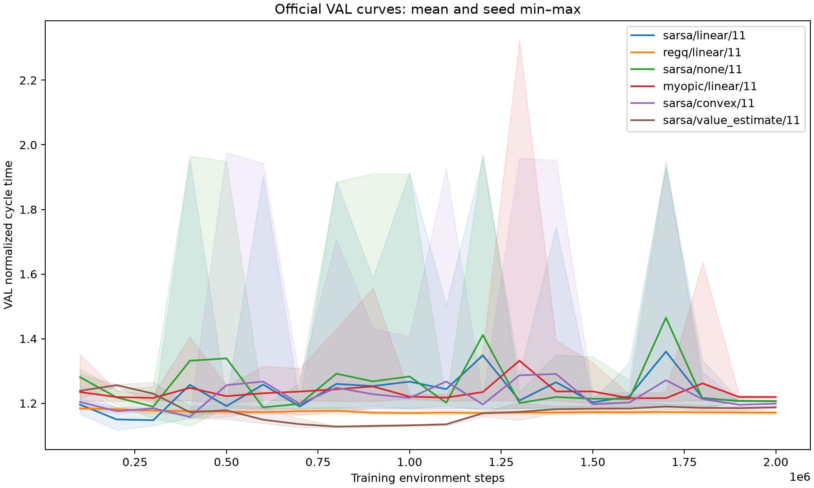
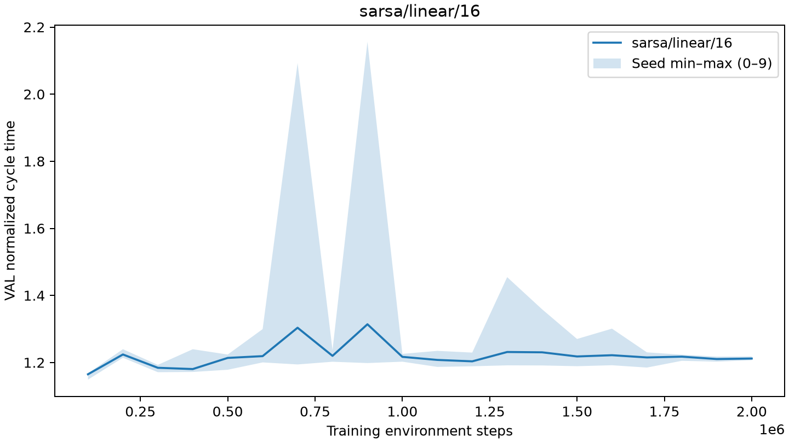

# Plan 002 official VAL report

Official seeds 0–9, 2000000 steps; final-10% tail policy. Equal means over parts, variants and seeds. Censored episodes retained with success.
The 16-feature arm is exploratory, VAL only, and excluded from hypotheses/test. Final weights are secondary and never selected.
Alpha normalization differs between methods (D-054); Phi ablations inherit the linear-arm setting. These are limitations, not corrected by extra tuning.

| Arm | 271875 | 37275 | 591247 | Mean | Raw seconds | Success | Diverged | Final weights (secondary) | Final success |
|---|---:|---:|---:|---:|---:|---:|---:|---:|---:|
| sarsa/linear/11 | 1.288124 | 1.096010 | 1.237376 | 1.207170 | 64.416 | 1.0000 | 0/10 | 1.236107 | 1.0000 |
| regq/linear/11 | 1.196886 | 1.094266 | 1.222234 | 1.171129 | 62.411 | 1.0000 | 0/10 | 1.175901 | 1.0000 |
| sarsa/none/11 | 1.286816 | 1.096010 | 1.236479 | 1.206435 | 64.377 | 1.0000 | 0/10 | 1.329374 | 0.9000 |
| myopic/linear/11 | 1.306725 | 1.105897 | 1.245985 | 1.219536 | 65.088 | 1.0000 | 0/10 | 1.221891 | 1.0000 |
| sarsa/convex/11 | 1.272619 | 1.096010 | 1.228242 | 1.198957 | 63.970 | 1.0000 | 0/10 | 1.238702 | 1.0000 |
| sarsa/value_estimate/11 | 1.261204 | 1.107994 | 1.193347 | 1.187515 | 63.370 | 1.0000 | 0/10 | 1.192798 | 1.0000 |
| sarsa/linear/16 | 1.299398 | 1.098494 | 1.237693 | 1.211862 | 64.681 | 1.0000 | 0/10 | 1.329719 | 0.9000 |

Canonical ENV v4 VAL baselines (Plan 001):

| Baseline | 271875 | 37275 | 591247 | Mean | Success |
|---|---:|---:|---:|---:|---:|
| greedy_cost | 1.238874 | 1.084520 | 1.235653 | 1.186349 | 1.0000 |
| mcts | 1.150973 | 1.099180 | 1.063176 | 1.104443 | 1.0000 |
| ilp_tsp | 1.000000 | 1.000000 | 1.000000 | 1.000000 | 1.0000 |
| joint_opt | 0.969566 | 0.985025 | 0.997196 | 0.983929 | 1.0000 |
| random | 1.997041 | 2.126578 | 2.222583 | 2.115401 | 0.4333 |
| fixed | 1.463897 | 1.508543 | 1.483918 | 1.485453 | 1.0000 |
| greedy_ig | 1.301743 | 1.122307 | 1.250004 | 1.224685 | 1.0000 |

Measured batch wall time: 4839.62 s (1.344 h), 20 workers.

Individual arm PNG/PDF figures are in figures/. Ranges describe seeds, not confidence or bootstrap intervals.
This VAL-only table makes no hypothesis verdict. The separately authorized completed test evaluation is reported in test_v1.md.

## Model limitations (reported with every result)

- Ideal sensor (D-025): a sample is measured or not (binary); in reality precision falls gradually with the incidence angle (first order ~1/cos α). Multiple reflections on shiny surfaces, the lower accuracy at the ends of the laser line, and measurement noise are not modeled; the camera's field of view is assumed to cover the whole line. The analytic sweep itself only neglects the discrete profile spacing (0.1 mm at 100 mm/s and 1 kHz).
- Single setup without turntable (D-025, D-027): interior and table-facing surfaces are not measurable by any optical sensor from outside; coverage is relative to the reachable union (D-023).
- Reachability is checked at 5 samples along each sweep with a joint-step limit (D-021); transfers between passes are not checked. Robot–part and robot–table collisions are checked statically at those samples with capsules and a sensor-head box (D-042); transfers, self-collision and fixtures are not.
- Cycle time excludes data processing (registration, CAD comparison) (D-036).
